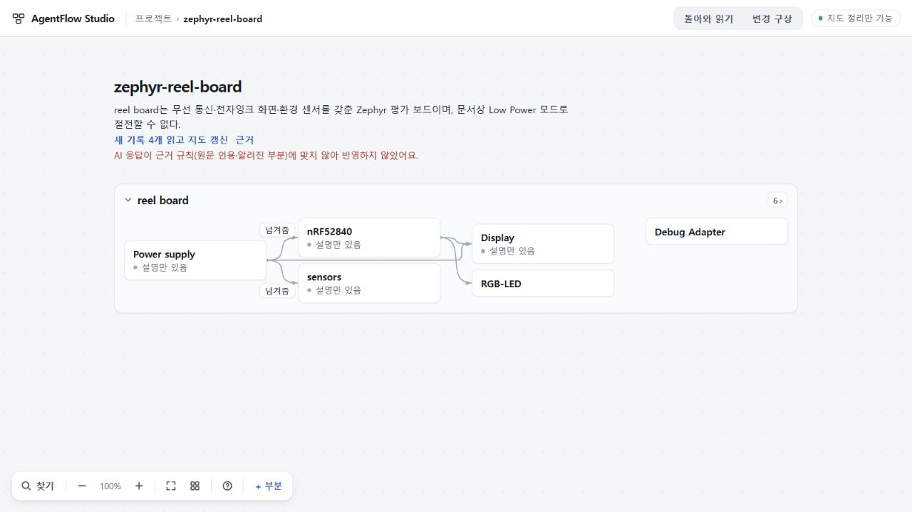

# 115 실제 반환 읽기 — 전달 완료, 조건 출처 계약 반려

**반려한다.** 114의 정상 자료 입구와 엄격한 source-kind 구별은 작동했지만, 새 응답은 사용자가 적은 파일 판본을 코드 원문이 말한 조건처럼 넣었다. 응답 전체를 적용하지 않았다. 114 구현 수용은 유지하고,115를 실제 요청→반환 읽기 성공으로 세지 않는다.

## 실제 관측

[사전선택](SELECTED.md)의 원래111/113 기록과109 전체요청 묶음에서 새 정상 사본을 만들고110 실제 파일 두 개를 추가했다. 선택된RQ0797과자료4건(typed code2/pasted report2)만 보냈다. 기존Zephyr원문2는 저장·현재지도에 남지만 이번ask에는 포함되지 않는다.

- 실제SolHigh top-level1회,버전probe1회,재시도/대체0. 기존299/300초정책 안에서 **177.952초,exit0**. 허용event4/tool0/error0/capture잘림없음.
- 최종10643byte,SHA256 **02a5467ebd07fdb5b70325640a2cde7187a93e8eba0e57a83d1efff2f7603ba6**. JSON.parse성공. stored결과는 INVALID_RESPONSE / CONTRACT. 시간초과·빈출력·JSON구문오류가 아니다.
- Sol 독립검토는 원wire/원ask그대로 validator1회만 실행했다. 첫실패는 matches[3].about: R02.30–35 코드에 사용자기재판본6d9c2ab전체SHA를 넣었으나 그 문자열은 R02원문에 없다. matches4–7도같은문제다. 코드 원문이 인용한 Zephyr3568커밋과 제공파일의6d9판본은 서로다르다.
- 이번 code대응5건은 모두정상 evidence자료 R01/R02를인용했다. 113의 pasted→code종류위반이 반복된 것은 아니다. roleAbout/일부claimabout의metadata복사도같은출처경계이며현재parser가일부문자열형식만검사하는차이를추가확인했다. 전체wire삭제·수리·재태그·재검증0.

## 성공으로 확대하지 않는 내용 관찰

원응답에는 두라벨의GDEH모델/컨트롤러/ssd16xx/보드지정,trim만하는대소문자구분일치,미상일때네값비움,LowPower제한유지,로컬PC시제품과변하지않은하드웨어의구별이있다. 작성자와root의검사를 각각조건부보고로읽고,과거반려RQ를연결하거나기존하드웨어를대체하지않았다. 그러나조건출처계약을어겼으므로이관찰을의미PASS나사용가능한부분결과로세지않는다.

## 정상 화면과 데이터 보존

실행 중 홈으로 나가 다른 프로젝트의94자초안을썼다. 원프로젝트로돌아오면근거규칙에맞지않아반영하지않았다는안내를표시했다. 원프로젝트전체는생성전·실패후·새로고침후 **dd5b31e0792d71ae5fa1aa625a23a0728e1e6742fee89324140f12f6c60b5e54**로동일했다. 첫지도1/기록6/부분7과전체요청bundle **cdf2dc70965e8eaf9c6d701dcef39a022d1baab8e0e0fcf047e4941590f8ba05**를유지했다. 다른프로젝트초안도유지했다. 자동반영0/새읽기0. 실패안내는ack/새로고침후사라지는기존한계가있다.

서버와자식실행은종료했고runs폴더는비었다. 임시화면을닫고viewport를복구했다. 공개73·미수용74·UI수용75/693·키·stash보존,배포/병합0.

## 다음 선택

116은 **사용자기재출처와원문조건을명시적으로분리하는작은응답계약**부터설계한다. 기존record.evidence와citation정체성으로사용자기재판본을표시하고,모델이이를원문about문자열로재작성하게하지않는다. 원문에있는검사조건은기존anchored구간참조로표현해결정적으로해석하는안을검토한다. role/claim/candidate/match의조건기준을함께확인하고기존저장형식·옛판본을보존한다. metadata를기존rawgate에단순추가허용하거나옛115/113 wire를수선하는안은배제한다. 새owner/store/queue나실행시간확대,같은입력재생성은선택하지않았다.

[최소전달증거](evidence/receipt.json) · [보존증거](evidence/preservation.json) · [원최종응답](evidence/final-message.txt) · [독립판정](evidence/independent-review.json) · [입력범위](evidence/preflight.json).
