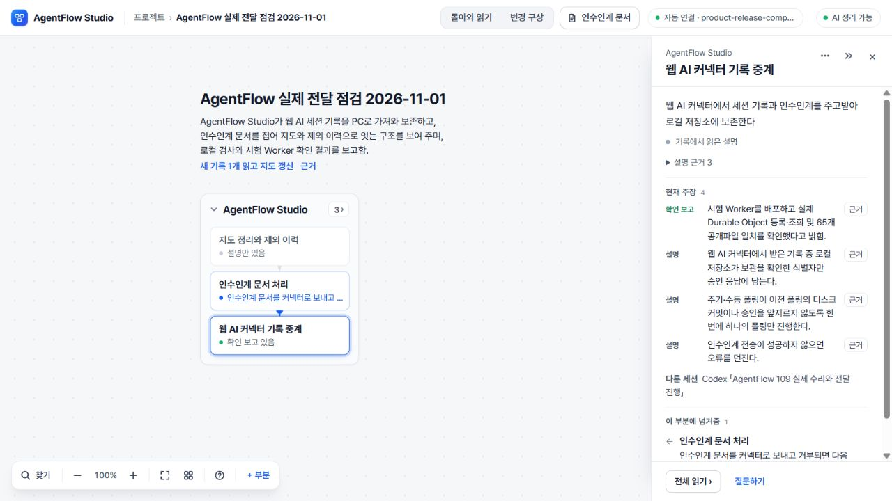
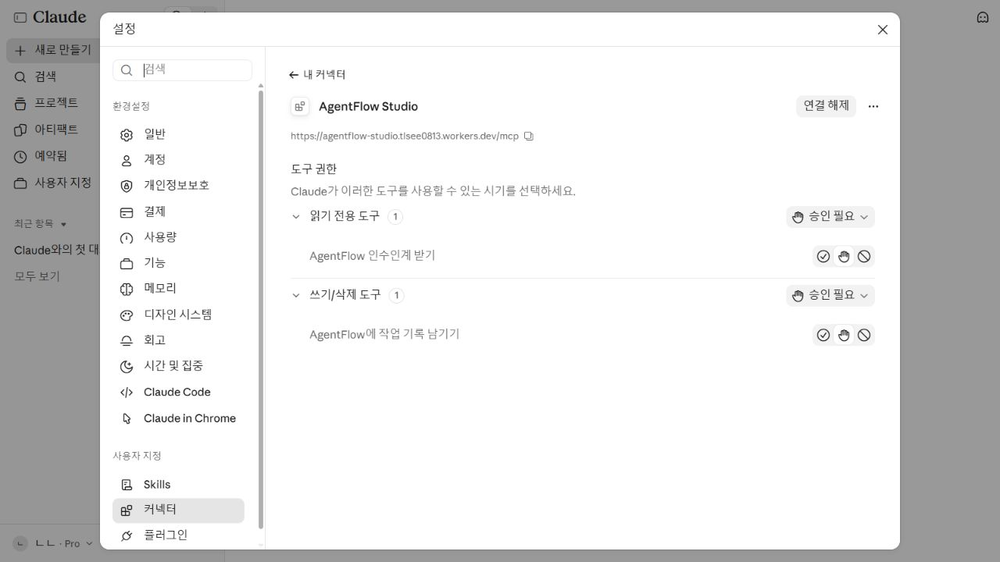

# 2026-11-01 사용 전달 마무리

기준 개발본은 `d0c37584bb89c6ff7ee7dea19ccb4714acd66e37`(PR107)이다. PR93–105의 기록 연결·결과 대조 수리와 PR106–107의 화면 개선을 유지하고, 총괄 검토에서 재현한 누락·근거·인수인계 문제를 수리한다. PR 번호와 과거 사이클 번호는 별개다.

**판정: 사용자가 직접 써 볼 수 있는 전달본의 수리·병합·배포·실제 연결 확인을 완료했다. 전체 의미 정확성이나 모든 복잡한 사례의 완성을 뜻하지 않는다.** 최종 확인 상태는 아래 전달 영수증을 따른다.

## 수리와 증거

| 문제 | 수정 | 실행한 검증 |
| --- | --- | --- |
| PC 저장 실패 뒤 재조회에서 클라우드 기록을 수신 완료로 잘못 처리 | 변경과 파일 교체를 직렬화하고 디스크 저장 성공 후 메모리를 확정. 저장된 유효 ID만 ACK | ENOTDIR 실패 반복→복구, 동시 poll, 재시작 후 원문 회수 |
| 동시 OAuth code/refresh 교환이 두 번 성공 | SQLite Durable Object 트랜잭션으로 한 번만 소모, 바인딩 누락 시 거절 | 오래된 KV 읽기를 재현한 16개 동시 교환에서 한 번만 성공 |
| 다른 프로젝트의 기록 100건 뒤에 있는 기록이 안 보임 | 프로젝트 조건에 맞는 기록을 고를 때 저장 목록의 다음 페이지까지 조회 | 다른 프로젝트 390건 뒤 및 기존 KV 501번째 기록 회수 |
| 499건에서 동시 쓰기로 한도를 넘겨 조회에서 빠짐 | 새 SQLite 저장소에서 개수 확인과 저장을 하나의 트랜잭션으로 처리 | 실제 MCP 처리기 2개에 동시 요청 16개: 1개 수락·15개 거절·총 500건 |
| 긴 파일 목록을 포함해 클라우드가 수락한 기록을 PC가 거절 | 공유된 전체 기록 한도 124,952 UTF-16자, HTTP 753,808바이트. 마스킹 후 초과는 성공 전에 거절 | 120,819자 기록의 MCP→PC 디스크→재시작→브라우저 프로젝트 저장·파싱 원문 동일 |
| 버린 주장·후보의 조건이 자료 구간 판정에 남음 | 검증 실패 때 조건을 되돌리고 최종 생존 항목만 조건을 소유 | 주장·부모·후보·대조의 탈락 반례 |
| 긴 인용의 뒷부분을 버리면서 주장은 채택 | 600자 초과 인용은 해당 항목을 제외. 잘라 채택하지 않음 | 유일한 지지 문장이 끝에 있는 1,087자 원문 반례 |
| 제외된 부모의 하위 부분이 조용히 빠짐 | 살아남은 부모 계보로 배치하고 하위 부분·의존 참조에 제외 사유를 남김 | map.6 부모 인용 탈락→자식·관계·후보의 명시 제외 |
| 제외 이유가 일시 안내로만 남음 | `map-reading.6`에 사유·응답 위치·원문 범위를 저장, 이력 UI·백업·인수인계에서 안내 | .4/.5 원래 모양 보존, .6 저장/재불러오기, 나중의 정상 읽기 뒤에도 이전 사유와 원문 왕복 |
| 끝 표시 없는 인수인계가 새 요청을 삼킴 | 완전한 문서만 접고 불완전한 원문은 보존. 다음 인수인계는 경계 불명·생략을 알리고 끝부분 표시 | `### 다음 작업` 보존, 완전+불완전 문서 28,548자 재현에서 앞 문서만 접어 실제 요청과 계보 보존 |

기존 프로젝트 전체 8MB, 기록 개수, AI에 보내는 구간·요청 크기 제한은 유지한다. 과거 60,000자 기록 한도 설명은 당시 결과이며 현재 입력 한도와 구별한다. 불완전한 인수인계도 기존 세션 가져오기 길이 제한보다 긴 원문 전체를 무제한 보장하는 것은 아니다.

독립 검토에서 긴 기록과 501번째 기록, 인수인계의 다음 문서 요약, 제외된 부모의 자식 누락을 추가 재현했다. 각 원래 반례를 수정 후 다시 확인하며, 최초 통과를 전체 완료로 취급하지 않았다. 로컬 비공개 원문·키·전체 로그는 GitHub에 올리지 않는다.

## 배포 선택

기존 토큰으로 Workers 설정 조회는 성공하고 Workers KV 네임스페이스 조회는 권한 오류였다. 새 연결기에는 아직 기존 KV 데이터가 없으므로 Workers의 SQLite Durable Object를 사용한다. OAuth 단일 소모와 기록 보관을 같은 지원 저장 기능으로 처리한다. 기존 KV 배포는 명시적 `CONNECTOR_STORAGE=kv`로 유지하며 저장소를 자동 전환하지 않는다.

공식 근거: [SQLite 저장 API](https://developers.cloudflare.com/durable-objects/api/sqlite-storage-api/), [저장 제한](https://developers.cloudflare.com/durable-objects/platform/limits/), [무료·유료 지원 범위](https://developers.cloudflare.com/durable-objects/platform/pricing/). SQLite의 키+값 2MB 제한 안에서 기록을 보관한다. 환경 재설치·계정 전환·KV 권한 확대는 하지 않는다.

공개 전체 Worker와 예제 Pages에 검증본을 전달했다. 별도 제한 공개142와 과거73 소스·결과, UI75 `693d0c7`, 미수용74의 판정은 보존한다. 새 연결기는 저장소 소유자의 GitHub 로그인에 한정한다. 예제 Pages는 AI 서버 없는 체험판임을 첫 화면에 표시한다.

## 검증을 읽는 기준

- 자동 테스트와 합성 OAuth 전송은 실제 GitHub 로그인·Claude 웹 연결의 성공 증거가 아니다.
- 과거 실제 AI 결과와 이번 전달·저장 검증을 구별한다. 완료한 연구나 실패한 모델 실험을 다시 시작하지 않는다.
- 새 `.6` 저장 형식을 읽는 최신 앱으로 업그레이드한다. .4/.5 백업은 그대로 지원한다.
- 사용자 PC의 기존 키 파일·작업 트리·25개 저장 파일을 먼저 보존했다. 브라우저의 기존 프로젝트는 같은 주소에서 유지한다.

처음 사용할 경로는 [PC 사용 안내](../../USE_STUDIO_KO.md), 현재 전체 상태는 [ACTIVE](../../cycles/ACTIVE.md)에 모은다.

## 실제 자료와 의미 판정

현재 수리 기록(사용자 요청·작업 보고·공개 commit/diff, 답변12,141자)을 정상 stdio MCP로 남겼다. PC 자동 연결에서 DeepSeek 1회가 약78.626초 뒤 도착했고, 부분 선택→원문→복귀·새로고침·정상 백업·MCP 인수인계를 확인했다. 원문12,629자는 보존하고11,914자를 읽었다. 끝715자는 미전송이며 화면에 일부 구간 읽기와 미확인 사항을 알렸다.

독립 의미 검토: 근거 인용28개는 원문과 정확히 일치했다. 사용자 마무리 요구, ACK/폴링, 불완전 인수인계 보존과 당시의 “정식 배포·PC 전달 미완료” 보고를 구분했다. 다만 지도 제외 이력을 인수인계로 넘긴다는 관계1건은 절 이름 상수만 근거로 실제 동작을 강하게 해석했고, 인수인계에도 그대로 남았다. **부분읽기·전달은 제한 수용, 전체 의미 정확성은 미수용**이다. 같은 결과를 재생성해서 실패를 덮지 않았다.

이 백업을 최종PC에서 폴더에 연결할 때 미전송 구간 때문에 자동 지도 갱신이 추가로 시작되어9초 안에 취소했다. 상태 cancelled/seen, 새 결과 적용0을 확인하고 원래 결과를 보존했다. 따라서 이번 완료 생성은1회이고, 추가 자동 접수·취소1회를 별도 기록한다. 이를 두 번째 의미 성공으로 세지 않는다. 이전 실제 요청·반환 대조는 [PR105 작성자 결과](https://github.com/tlsee0813-cmd/agentflow-studio/pull/105)를 회수했으며, 이번에 같은 모델 실험을 재실행하지 않았다.

## 실제 Claude 인증에서 발견한 추가 수리

사용자 승인 뒤 GitHub 인증·PC 연결키 발급과 저장은 성공했지만, Claude OAuth의 동의 폼에서 GitHub→Worker callback→Claude 복귀가 브라우저 CSP에 막혔다. 네트워크의 ERR_ABORTED와 form-action 차단 로그를 직접 확인했다. [PR110](https://github.com/tlsee0813-cmd/agentflow-studio/pull/110)은 **현재 클라이언트에 등록되어 대조·검증된 콜백 origin 하나만** 동의 화면의 form-action에 추가한다. 와일드카드·다른 클라이언트 origin·동의/PKCE/계정 제한 완화는 없다. CLOUD-15는 수정 전 실패를 확인한 뒤 통과했고 독립 검토에서 P1/P2가 없었다.

## 전달 영수증

| 전달 대상 | 확인한 판본·결과 |
| --- | --- |
| 코드 | [PR109](https://github.com/tlsee0813-cmd/agentflow-studio/pull/109)·[PR110](https://github.com/tlsee0813-cmd/agentflow-studio/pull/110) 병합. 최종 코드  dc74b5439842d53567ff11b8ea89def5b4424d11, 병합 72447c4, [고정 태그](https://github.com/tlsee0813-cmd/agentflow-studio/tree/release/2026-11-01-studio) |
| 최종 CI | [41265216496](https://github.com/tlsee0813-cmd/agentflow-studio/actions/runs/41265216496) Windows·Linux 모두 성공. 기존 앱 각각 279개, continuity Linux 837개 / Windows 833개 통과·4개 건너뜀, 기존 브라우저 검사 18개 및 Studio 전체 화면 검사 통과. 유료 AI 호출 없음 |
| 정식 Worker | [웹 Studio](https://agentflow-studio.tlsee0813.workers.dev/) source dc74b54. 공개 파일 65개 SHA256 일치. 배포 d971a7e1-9fcc-4214-9f8b-0f8811ed9ec2, 버전 042a49f1-a50b-4f5f-8179-b0ed16d7e155 100% |
| 정적 Pages | [공개 예제](https://tlsee0813-cmd.github.io/agentflow-studio/) f903d3d/source4f7e019 실제 BUILD 확인. OAuth 후속 수리는 서버만 바뀌어 클라이언트는 동일. AI 서버 없음·저장 prefix 보존 |
| 실제 인증 | GitHub 공개 프로필 승인 → PC 키 발급·기존 환경 파일에 추가 → Claude OAuth 성공. 수정 전 CSP 실패와 수정 후 실제 복귀를 구분. 기존 PC 키는 Worker 재배포 후에도 유효 |
| 실제 웹↔PC | Claude에서 같은 프로젝트 인수인계 읽기 1회·기록 쓰기 1회 성공(각 한 번 허용, 항상 허용으로 변경하지 않음). 02:40:28.160Z 웹기록→02:40:45.725Z PC 디스크 저장, 약17.565초. 요청·답변 일치·cloud ID 커밋·원격 ACK 확인. 새 웹 기록의 추가 지도 생성은 하지 않음 |
| PC | 기본 4317 정상 시작(AI·세션·내구 작업·연결기 켜짐). 기존 키 값 보존, 승인한 클라우드 URL/키만 추가. 바탕화면 AgentFlow Studio 바로가기와 같은 실행 경로를 확인 |

정확한 기계 판독 요약은 [DELIVERY.json](DELIVERY.json), 수정 전 OAuth 브라우저 증거는 [oauth-csp-before.json](oauth-csp-before.json)에 있다. 원문·인증값·개인 대화 링크는 공개하지 않는다.

## 저장소와 보존

현재 README·사용 안내·ACTIVE·QUESTIONS·검토 시작점을 같은 판본으로 맞추고, 긴 과거 이력은 원문을 지우지 않고 접어 두었다. 기본 main은 안내만 업데이트하며 제품 계보를 억지로 합치지 않는다. [브랜치 정리와 복구](REPOSITORY.md)에 원 tip과 원격 태그를 남긴다. 진행 중 PR과 미수용·독자 계보는 유지한다.

사용자 PC의 기존키 값과 원래 기록을 보존했다. 연결 승인 전까지25개 저장파일 및 env hash가 같았고, 이후에는 승인한 AGENTFLOW_CLOUD_URL/KEY 설정과 검증 기록만 추가했다. 기존 환경 원문과 저장파일 백업은 PC 비공개 위치에 둔다. 현재 포트4317의 작업이 없는 것을 확인하고 연결 설정을 반영해 다시 켰다. 바탕화면 바로가기는 이미 동작하는 PowerShell7과 확인한 Node22.16을 사용하며 PATH·시스템 보호 설정을 변경하지 않았다.
