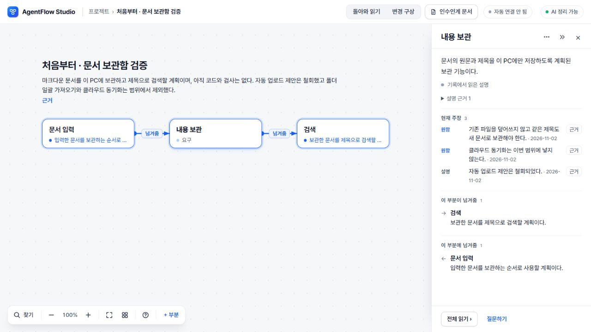
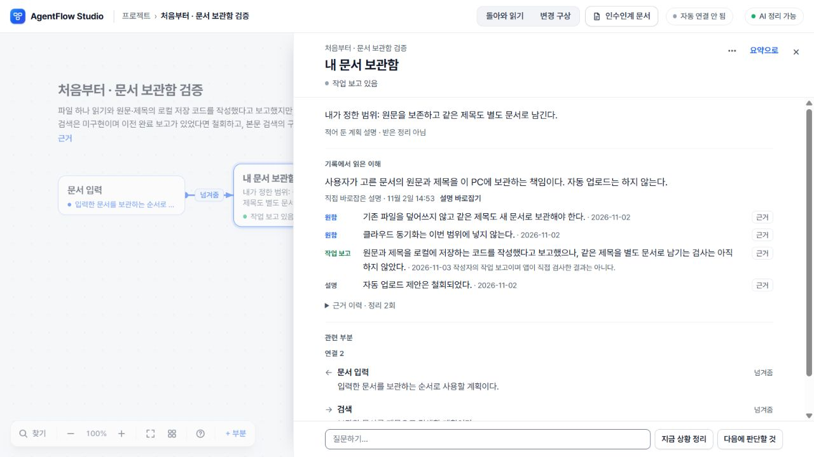
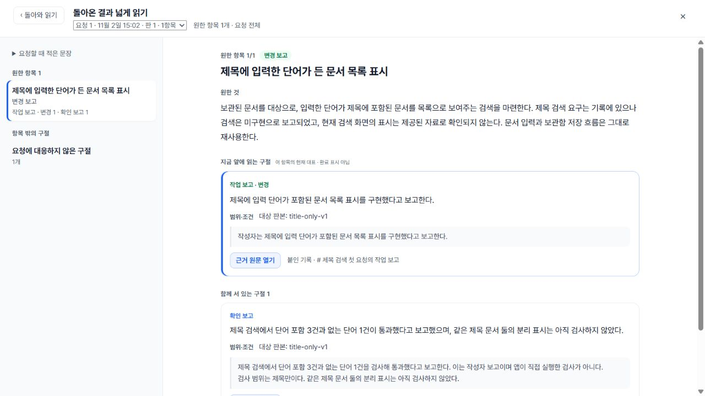

# 분할 지도 생성 — 실제 검증 중간 결과

PR #111 후보이며 아직 기존 PC·공개 Worker에 반영하지 않았다. 전체 제품 완성이나 모든 기록의 의미 정확성을 선언하지 않는다. 원본 실패와 이전 배포 이력을 보존한다.

## 실제 긴 기록

사용자가 제공한 11,562자 기록 전체를 4구간으로 읽었다. DeepSeek 추출 → Sol 6.1 High 전역 설계 → Terra 6.1 High 부분 작성·전역 대조로 7부분·7관계·1미정을 만들고 원문 참조 검증을 통과했다. 중요한 미구현, 폐기, 미채택, 현재 보고와 옛 체크아웃의 차이를 유지했다. 원문은 비공개이므로 공개 저장소에는 내용과 화면을 올리지 않는다.

- Sol의 작은 설계는 실제 106.3초에 완료됐다. 기존 단일 최종 통합의 180초 시간 초과와 구별한다.
- Terra 전체 부분·전역 작성은 105.1초, 해당 새 호출 비용 $0.133463이었다. 이 실행은 앞서 완료한 추출·설계를 재생했으므로 전체 신규 생성 시간이나 총비용이 아니다.
- Astra의 독립 검토 5건을 총괄과 Sol이 원문·계약으로 재판정했다. 성립 미정 후보의 명제를 확정 주장으로 읽은 지적은 오탐이었다. 원문에 없는 횟수 단위를 덧붙인 것은 실제 오류로 채택했다. 중요한 조건 선택과 모든 세부사항의 나열을 구별했다.
- 영향을 받은 부분 그룹 하나만 Terra로 다시 작성했다(39.0초, $0.033342). 나머지 성공한 원응답은 그대로 재사용했다. 수량 단위의 임의 해석을 없애고 권한·금지·변경 전제를 우선 보존했다. 최종 결합·인용 검증을 다시 통과했다.
- 정상 백업 가져오기로 격리 PC 화면에서 열어 지도, 현재 주장, ‘성립 미정’, 해당 원문 이동을 확인했다. 이는 이미 생성한 결과의 화면 검증이며 추가 AI 생성은 아니다.

## 처음 시작하고 계속 수정하는 흐름

정상 브라우저에서 작은 문서 보관함 요구를 저장하고 실제 전체 분할 생성을 실행했다. 문서 입력·내용 보관·검색이 모두 ‘요구’로 나왔으며 아직 코드·검사가 없다는 설명, 덮어쓰기 금지, 범위 제외와 제안 철회를 유지했다.

사용자가 고치는 경로로 이름·메모·역할을 각각 바꾼 뒤 후속 작업 보고를 저장하고 실제 map.7 분할 생성을 실행했다. 직접 수정한 세 항목과 원래 요구 근거를 보존했다. 작성자의 구현 보고와 미검사, 검색 미구현, 옛 요구에 관한 보고와 새 요구의 미확인을 구분했다. 새로고침 뒤 저장 상태와 정확한 원문 왕복도 확인했다. 고정 요청의 판본별 대응은 아래 별도 실제 사례로 확인했다. 자동 연결기의 새 전송 성공을 이번 생성 검증으로 대신 주장하지 않는다.

## 진행·저장·비용

근거 읽기, 전체 조건 대조, 부분 정리, 마지막 확인, 정리 교정의 진행을 해당 작업에만 표시한다. 원문이나 모델 문구를 진행 API에 복사하지 않는다. 완료·실패·취소 뒤 늦게 도착한 진행은 버리고 새로 연결한 화면은 인증된 조회에서 현재 상태를 회수한다.

Node 호스트는 서버 전용 설정에서 렌더 모델을 선택한다. 기본은 Terra이며 OpenAI 상한은 정리당 $1·월 $20이다. DeepSeek 요금은 별도이며 기본 배치에서는 추출 최대12회다. 명시적으로 DeepSeek 작성까지 선택하면 부분 재작성 1회와 단계별 형식 교정을 포함한 최대48회 상한을 적용한다. 화면도 실제 배치의 상한을 읽는다. 기존 키 파일과 사용자 데이터는 바꾸지 않았다.

전송 여부·과금이 불명인 단계는 자동 재시도하지 않는다. 원래 예약과 성공한 단계는 보존한다. 명시적인 추가 비용 승인과 불명 단계 재개 UI는 아직 남은 문제다. 현재의 단순 재클릭을 추가 과금 허가로 해석하지 않는다.

## 검증 경계

진행·호스트 통합 시점의 전체 검사 964개 중 960개 통과, 플랫폼별 4개 건너뜀, 실패 0이었다. 초기 후보 커밋 2aaaf2d의 Windows·Linux CI 41395571127도 통과했다. 이 뒤 독립 검토에서 전체 요약만 철회를 반영하고 부분의 기존 현재 주장을 남기는 경로를 재현했으므로 그 검사 결과로 최종 수용하지 않는다. 이후 아래의 정정 의무 및 중복 보고 수리를 완료했다.

형식·전송·저장 회귀, 실제 모델 응답, 정상 화면 조작, 외부 연결기 전송, 사람 사용성은 별도 증거다. 최종 전체 검사와 정확 커밋의 CI, PC 전달을 닫기 전 배포 수용으로 표시하지 않는다. 이전 실험의 거절·시간 초과를 새 성공으로 소급하지 않는다.

최종 수리 후 로컬 전체 검사: 989개 중 985개 통과, 플랫폼별 4개 건너뜀, 실패 0(74.6초). 타입·구문·클라이언트/서버 경계 검사도 통과했다. 정확 커밋 CI와 PC 전달은 아래 후속 영수증으로 구분한다.

## 고정 요청 두 판본의 실제 반환

제목 검색과 본문 검색을 서로 다른 두 고정 요청으로 만들고, 첫 요청의 구현·검사 보고를 정상 경로로 한 번 읽었다. 제목 검색의 변경·확인 보고는 첫 요청에만 연결됐고, 본문 검색은 완료로 바뀌지 않았다. 같은 제목 문서의 분리 표시도 미검사로 남았다. 생성 중 새로고침 → 진행 회수 → 도착 결과 명시 반영을 확인했다. 전후 내보내기에서 원문·이전 읽기·직접 수정한 이름과 메모·전체 변경안/고정 요청 묶음이 동일했다.

설계 단계의 명시적인 정정 의무를 정규화된 상세 주장과 대조하고, 해당 부분만 최대 한 번 다시 작성하도록 수리했다. 미해결이면 전체 반영을 보류한다. 독립 회귀에서 숨겨진 과거 중복 보고가 철회 후 되살아나는 문제도 발견해, 현재 주장 선택만 수리하고 원문·이력을 보존했다. 다른 부분·판본·주장 종류와 철회 후 새 재주장은 분리한다. 이 보호는 AI가 모든 의미적 철회를 찾아낸다는 보장이 아니다.

## 정상 화면 증거

합성 문서 보관함 프로젝트만 공개한다. 실제 사용자 기록·키는 포함하지 않는다.

