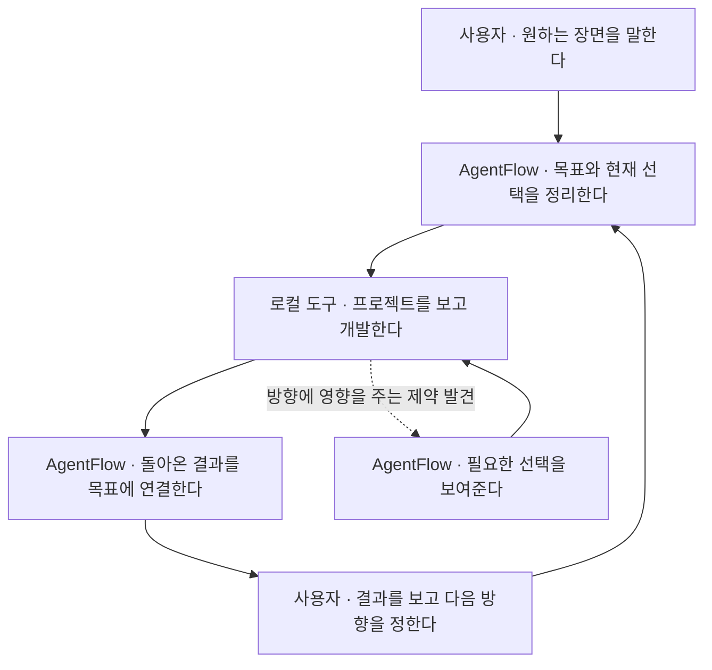

# firm 설계 의견 — 검토 후보

이 문서는 firm 조언 세션의 제품 설계 제안이며, 구현 완료나 전체 채택을 뜻하지 않습니다. 2026-10-13 총괄이 원문 전체를 읽고 개인 로컬 경로 한 줄만 제외했습니다. Work/Claude 독립 검토와 최종 제품 판단은 진행 중입니다.

**제품 설계안 · 2026년 10월 13일**

AgentFlow는 사용자가 만들고 싶은 것의 큰 방향을 유지하고, 지금 어디까지 왔으며 다음에 무엇을 하면 되는지 보여주는 작업 공간이다. 실제 저장소 조사, 구현, 테스트와 실행은 사용자의 로컬 개발 도구가 맡는다.

핵심 경험은 **“내가 원하는 모습과 실제 개발이 어떻게 이어지는지 한눈에 이해하는 것”**이다. 이를 위해 사용자가 기대하는 장면, 중요한 선택, 로컬에서 돌아온 결과를 연결한다. 개발 방법을 모두 일반화하기보다, 여러 개발 방식 사이에서도 이어져야 하는 맥락을 작게 관리한다.

## 1. 역할을 나누는 기준

| 주체 | 맡는 일 | 대표 질문 |
| --- | --- | --- |
| 사용자 | 원하는 결과, 우선순위와 중요한 선택을 정한다. | 무엇이 가능해지면 이번 작업이 의미 있을까? |
| AgentFlow | 목표를 정리하고, 선택과 결과를 연결하며, 다음 행동을 보여준다. | 이 작업은 왜 하는가? 무엇이 달라졌고 다음에 무엇을 하면 되는가? |
| 로컬 개발 도구 | 실제 프로젝트를 읽고, 구현 방법을 판단하고, 개발·테스트·실행을 수행한다. | 이 저장소에서는 어떻게 만들 수 있고, 실제로 무엇이 되었는가? |

AgentFlow가 알아야 할 것은 모든 프로젝트의 정답이 아니라 **사용자의 의도와 실제 결과 사이의 관계**다. 코드 구조, 프레임워크별 작업 순서, 테스트 명령 같은 세부사항은 프로젝트를 직접 보는 로컬 도구가 결정한다.

연결 방식은 처음에는 작업 내용 복사와 결과 가져오기만으로도 성립한다. 자동 연결은 전달의 수고를 줄이는 확장 기능이다. 연결 방식이 달라져도 사용자가 보는 큰 흐름은 유지한다.

## 2. 사용자가 이해하는 기본 흐름



사용자는 매번 긴 계획서를 만들 필요가 없다. “예약을 취소할 수 있게 하고 싶다”처럼 한 장면에서 시작한다. AgentFlow는 이번에 원하는 결과와 이미 정한 조건을 전달하고, 로컬 도구는 실제 프로젝트에서 가능한 방법을 찾는다.

로컬 조사에서 중요한 갈림길이 생기면 선택지를 돌려준다. 예를 들어 취소 자체는 가능하지만 결제 취소는 별도 연동이 필요하다면, 사용자가 이번 범위를 정하도록 한다. 이미 방향이 명확한 작은 수정은 바로 개발로 넘어간다.

결과가 돌아오면 AgentFlow는 작업 로그 전체보다 **무엇이 가능해졌고, 무엇이 남았으며, 다음 행동이 무엇인지** 먼저 보여준다. 사용자가 직접 확인한 내용과 로컬 도구가 보고한 내용은 출처를 표시해 구분한다.

이 흐름은 고정된 개발 단계가 아니다. 간단한 수정은 한 번에 끝나고, 불확실한 기능은 작은 실험을 거쳐 다시 방향을 잡을 수 있다.

## 3. 첫 화면은 프로젝트의 현재 모습을 보여준다

첫 화면에서 사용자가 답을 찾을 수 있어야 하는 질문은 네 가지다.

- 무엇을 만들고 있는가?

- 지금 어디까지 왔는가?

- 내가 지금 정할 것이 있는가?

- 다음에는 무엇을 하면 되는가?

### 화면 구성 예시

아래는 예약 서비스에서 로컬 작업 결과가 돌아온 순간의 화면이다. 문구와 배치는 설계 예시다.

```text
예약 서비스
고객이 스스로 예약을 관리할 수 있게 만들기

원하는 장면
  예약하기          사용자가 동작을 확인함
  예약 취소하기     로컬 결과가 돌아옴 ← 현재
  운영자가 알기     아직 시작하지 않음

지금 볼 내용
  취소 버튼과 빈자리 복구가 구현되었다고 보고됐어요.
  실제 예약 하나를 취소해 흐름을 확인할 수 있어요.

  [결과 확인 방법 보기]  [확인한 내용 남기기]

다음에 정할 것
  운영자 알림을 어디로 받을까요?
  실제 알림 전송을 붙이기 전에 정하면 돼요.

  [선택지 보기]  [나중에 정하기]

자세히 보기
  이번 작업 내용 · 선택한 이유 · 로컬 보고 · 지난 변경
```

**전체 지도에는 사용자가 할 수 있게 될 일을 놓는다.** “API 개발”, “DB 수정” 같은 구현 작업은 해당 장면을 펼쳤을 때 나타난다. 장면 사이의 모든 관계를 거대한 그래프로 보여줄 필요는 없다.

**현재 작업은 하나를 중심으로 보여준다.** 다른 작업은 유지하되, 지금 읽고 행동할 대상을 분명하게 한다. 프로젝트 전체를 볼 때도 현재 위치가 사라지지 않도록 한다.

**다음 행동은 현재 상태에 맞춰 바뀐다.** 전달 전에는 “로컬에 전달”, 결과가 돌아오면 “결과 확인”, 중요한 제약이 생기면 “방향 선택”을 보여준다. 할 일이 쌓였다는 이유로 모든 버튼을 같은 비중으로 노출하지 않는다.

**상태는 관찰 가능한 말로 쓴다.** “작업 전달됨”, “로컬 결과가 돌아옴”, “사용자가 확인함”처럼 표현한다. 실제 연결이 없는 상태에서 “실행 중”을 표시하거나, 작업 개수만으로 전체 완성률을 계산하지 않는다.

## 4. 개발 흐름을 단순하게 만드는 다섯 가지 아이디어

### 4.1 로컬 도구가 구현 경로를 제안한다

AgentFlow가 목표와 조건을 전달하면, 로컬 도구는 저장소를 보고 이미 있는 것, 필요한 작업, 사용자가 정해야 할 선택을 돌려준다. AgentFlow는 그 제안이 원래 목표와 맞는지 정리한다.

예를 들어 “예약 취소”라는 요청에 로컬 도구가 “예약 상태를 바꾸는 기능은 이미 있고 화면을 연결하면 된다. 자동 환불은 결제 연동이 추가로 필요하다”고 답할 수 있다. 사용자는 기술 구현 전체를 몰라도 “이번에는 취소까지”라고 선택할 수 있다.

이 방식은 AgentFlow가 프로젝트마다 다른 개발 방식을 미리 모델링해야 하는 부담을 줄인다. **새 프로젝트의 첫 작업이나 큰 변경에 유용하며, 명확한 작은 수정에는 제안 단계를 생략한다.**

### 4.2 기능 목록 대신 완성될 장면을 연결한다

장면은 사용자가 행동했을 때 어떤 일이 일어나야 하는지 표현한다.

> 고객이 예약을 취소한다 → 자리가 다시 열린다 → 운영자가 취소 사실을 안다.

이 장면 아래에 선택한 조건, 관련 로컬 작업, 돌아온 결과가 연결된다. 사용자는 “파일 열두 개를 수정했다”는 설명보다 “취소는 되고 운영자 알림은 남았다”는 설명으로 현재 상태를 이해한다.

게임이라면 “공격이 맞았음을 알아차리고 다음 행동을 선택한다”, 업무 도구라면 “담당자가 바뀌어도 미처리 건을 이어받는다”가 장면이 될 수 있다. 공통점은 기술 분류가 아니라 사용자에게 생기는 변화다.

장면을 처음부터 완벽하게 분해하지 않는다. 하나로 시작해 작업이 커졌을 때 나눈다. 스타일 수정처럼 작은 일은 기존 장면에 바로 연결한다.

### 4.3 아직 정하지 않아도 되는 것은 남겨둔다

미정 항목을 모두 즉시 답해야 하는 질문으로 만들지 않는다. 각 선택에 **언제 필요해지는지**와 **그전에 진행할 수 있는 일**을 붙인다.

| 아직 정하지 않은 것 | 결정이 필요한 시점 | 먼저 할 수 있는 일 |
| --- | --- | --- |
| 이메일 또는 문자 알림 | 실제 전송 기능을 붙이기 전 | 취소 이벤트와 알림 내용 정리 |
| AI 대화 또는 정해진 대사 | 실제 대화 엔진을 붙이기 전 | 대사 예시로 원하는 상호작용 확인 |
| 회원가입 필수 여부 | 예약 소유자 확인 방식을 확정하기 전 | 날짜와 시간 선택 흐름 확인 |

현재 행동의 목적도 구분할 수 있다. “이번에는 만든다”와 “이번에는 판단할 재료를 얻는다”가 모두 정당한 진행이다. 사용자가 등록 화면을 직접 보고 싶다면, 전체 인증 구조를 먼저 정하기보다 화면 시안으로 필요한 경험부터 확인할 수 있다.

이 구분은 거대한 계획표 없이도 불확실성을 다루게 해준다. 임시 선택은 임시로 유지하고, 이후 작업이 그것을 확정 조건으로 잘못 이어받지 않게 한다.

### 4.4 요구가 바뀌면 달라지는 부분을 보여준다

사용자가 “회원가입 없이도 예약하게 하자”고 하면 전체 계획을 다시 작성하기보다 다음처럼 보여준다.

| 구분 | 사용자에게 보여줄 내용 |
| --- | --- |
| 그대로 이어갈 수 있는 부분 | 날짜·시간 선택, 예약 가능 인원 |
| 다시 살펴볼 부분 | 예약 소유자 확인, 취소 권한 |
| 새로 필요한 선택 | 예약 조회·취소 링크를 어떻게 전달할지 |

위 표는 이해를 돕는 예시이며 실제 코드 영향은 로컬 도구가 확인한다. AgentFlow는 사용자 선택과 장면 사이의 연결을 관리하고, 로컬 도구는 저장소의 변경 범위를 판단한다.

사용자에게 중요한 것은 “이전 정보가 낡았다”는 경고보다 **어디서부터 이어가면 되는지**다. 처음에는 선택과 장면의 단순한 연결로 시작하고, 실제로 필요해진 관계만 추가한다.

### 4.5 반복해서 도움이 된 방식을 경험으로 남긴다

재사용의 출발점을 템플릿 목록뿐 아니라 실제 작업 경험으로 넓힌다. “화면을 먼저 봤더니 요구가 명확해졌다”, “이 정도 수정에는 별도 설계 단계가 필요 없었다”처럼 상황과 결과를 함께 남긴다.

다음에 비슷한 작업이 생기면 “지난번에는 화면을 먼저 확인하는 방식이 도움이 됐어요”라고 제안할 수 있다. 사용자가 거절하거나 상황이 달라졌다면 그대로 진행한다. 한 번의 수정 요청을 영구 규칙으로 승격하지 않는다.

경험이 쌓인 뒤 반복 부분을 작은 단위로 나누어 조합할 수 있다. **조립 방식은 경험을 재사용하는 여러 방법 중 하나**이며, 첫 버전부터 범용 조립 엔진이 필요하다는 뜻은 아니다.

## 5. 예약 취소 기능으로 보는 전체 경험

### 시작할 때

사용자: “고객이 예약을 직접 취소하게 하고 싶어.”

AgentFlow는 “고객이 취소하고, 자리가 다시 열리는 장면”을 정리한다. 운영자 알림과 환불은 기존 조건이 있는지 살피고, 아직 정해지지 않았다면 미정으로 남긴다. 처음부터 모든 선택을 답하게 하지 않는다.

### 로컬에서 프로젝트를 본 뒤

로컬 도구: “예약 상태 변경 기능이 있습니다. 고객 화면을 연결할 수 있습니다. 자동 환불은 별도 작업이 필요합니다.”

AgentFlow는 코드 설명을 필요한 선택으로 바꿔 보여준다. “이번에는 예약 취소와 빈자리 복구까지 진행할까요?” 사용자가 “응, 환불은 다음에”라고 답하면 그 범위와 이유가 남는다. 같은 범위를 이후 단계에서 반복 승인받지 않는다.

### 개발 결과가 돌아왔을 때

로컬 도구가 구현 내용과 테스트 결과, 확인 방법을 돌려준다. AgentFlow는 이 결과를 “예약 취소하기” 장면에 연결한다.

사용자는 먼저 “취소 버튼과 빈자리 복구가 구현되었다고 보고됨”을 본다. 필요하면 테스트 결과와 변경 내용을 펼친다. 직접 실행해 확인한 뒤에는 “사용자가 확인함”이 별도로 남는다. 로컬 보고만 도착한 상태를 사용자 확인으로 바꾸지 않는다.

### 방향이 달라졌을 때

사용자: “그런데 회원가입 없이도 취소할 수 있게 하고 싶어.”

AgentFlow는 기존 취소 흐름과 이어갈 부분을 유지하고, 본인 확인과 취소 링크 전달 방식을 새 선택으로 보여준다. 로컬 도구에는 달라진 조건과 영향을 확인할 대상을 보낸다.

이 경험에서 AgentFlow가 제공하는 가치는 매번 개발 방법을 새로 설계하는 데 있지 않다. **사용자가 바꾼 의도가 다음 개발에 정확히 이어지고, 돌아온 결과를 같은 맥락에서 이해할 수 있게 하는 데 있다.**

## 6. firm에서 가져올 만한 메커니즘

firm의 재사용 단위와 조립 아이디어는 활용할 수 있다. 여기에 확정 자료와 후보를 구분하는 방식, 다음 작업을 현재 상황에 맞춰 정하는 방식까지 함께 가져오면 AgentFlow의 범용화를 작게 유지할 수 있다.

| firm에서 참고할 생각 | AgentFlow에 적용할 모습 | 적용 시점 |
| --- | --- | --- |
| 기준 자료와 활용을 분리한다. | 사용자 목표·선택은 유지하고, 이번 로컬 작업은 현재 상황에 맞게 구성한다. | 처음부터 |
| 후보와 확정 자료를 구분한다. | 로컬 제안, 임시 선택, 사용자 결정이 서로 섞이지 않게 한다. | 처음부터 |
| 최신 결과를 받아 다음 작업을 구성한다. | 모든 개발 단계를 미리 고정하지 않고, 돌아온 결과에서 다음 행동을 정한다. | 처음부터 |
| 자료의 출처와 계보를 남긴다. | 결과가 어느 작업과 어느 선택에 대한 것인지 연결한다. | 처음부터 |
| 실제 두 번째 활용처를 보고 공통 부분을 뽑는다. | 서로 다른 작업에서 반복된 방식이 보일 때 재사용 단위를 만든다. | 반복 사용 이후 |
| 받아들이지 않은 판단도 남긴다. | 어떤 상황에서 특정 방식이 불필요했는지 다음 제안에 참고한다. | 경험 축적 이후 |

참고할 핵심은 구성요소의 개수보다 **기준은 유지하면서 활용은 상황에 맞게 바꾸는 구조**다. firm의 역할 그래프와 전체 운영 체계를 그대로 가져오는 대신, 사용자 경험에 필요한 메커니즘부터 적용한다.

## 7. 첫 버전과 확장 순서

### 첫 버전에서 연결할 하나의 경험

**원하는 장면 하나 → 로컬에 작업 전달 → 결과 가져오기 → 같은 장면에서 다음 행동 보기.**

첫 버전에는 장면 목록과 현재 작업, 중요한 선택과 미정 항목, 로컬 전달 내용, 결과를 연결하는 화면이 필요하다. 새로운 프로젝트나 큰 변경에서는 로컬 도구의 사전 제안을 받을 수 있게 한다. 작은 작업은 바로 전달한다.

한 화면에서 모든 이력을 펼치기보다 현재 상태를 먼저 보여주고, 이유와 원문은 상세 화면에서 찾게 한다. 사용자가 며칠 뒤 돌아왔을 때 지난 대화를 처음부터 다시 읽지 않고도 이어갈 수 있어야 한다.

### 이후에 추가할 기능

| 순서 | 추가할 기능 | 추가가 필요해지는 순간 |
| --- | --- | --- |
| 1 | 선택을 미루는 시점과 작은 실험 표시 | 미정 항목 때문에 진행이 멈추거나 성급한 결정이 반복될 때 |
| 2 | 요구 변경의 영향 표시 | 장면이 늘고, 무엇을 유지할 수 있는지 찾기 어려워질 때 |
| 3 | 경험을 바탕으로 한 방식 제안 | 서로 다른 실제 작업에서 도움이 된 방식이 반복될 때 |
| 4 | 반복 부분 조합과 로컬 자동 연결 | 같은 구성과 수동 전달의 반복이 뚜렷해질 때 |

이 순서는 제품 범위를 정하기 위한 제안이다. 다섯 가지 아이디어를 첫 버전의 필수 기능으로 묶지 않는다.

### 실제 사용에서 볼 기준

사용자가 현재 상태와 다음 행동을 쉽게 설명하는지, 로컬 도구에 같은 배경을 반복 입력하는 일이 줄었는지, 목표가 바뀌어도 기존 작업을 이어가는지 살핀다. 간단한 수정에서도 매번 AgentFlow에 들러 정리해야 한다면 절차를 줄인다. 화면의 정보량보다 **작업을 다시 이해하고 이어가는 수고**가 줄었는지가 중요하다.

## 8. 현재 AgentFlow와 이어지는 구현 방향

현재 코드에는 사용자 기준과 이력 보존, 작업 전달 기록, 반환 결과 연결, 기준 변경 후 오래된 AI 조언을 그대로 쓰지 않는 처리가 있다. 이 기반 위에 사용자가 이해하기 쉬운 장면과 다음 행동을 보여주는 층을 추가할 수 있다.

| 기존 기반 | 이어서 설계할 부분 |
| --- | --- |
| 기준과 변경 이력 | 각 선택이 어떤 장면에 영향을 주는지 연결 |
| 현재 작업과 수동 편집 | 장면 안에서 지금 할 행동을 강조 |
| 전달 기록과 결과 식별 | 돌아온 결과를 원래 목표 아래 배치 |
| 기준 변경에 따른 AI 조언 제외 | 다시 볼 부분과 이어갈 부분을 설명 |
| 출처와 보고 자료 | 사용자가 확인한 내용과 도구 보고를 화면에서 구분 |

공통 데이터는 원하는 장면, 선택과 이유, 현재 작업, 전달 및 반환 기록을 중심으로 둔다. 원문과 기존 식별 연결을 유지하고, 새 화면을 위해 동일한 기준을 별도 저장소에 중복 관리하지 않는다.

로컬 도구와 주고받는 내용도 목적 중심으로 둔다. 전달에는 원하는 결과·기존 조건·이번 범위를, 반환에는 수행 내용·막힌 점·확인 결과·필요한 다음 선택을 담는다. 모든 프레임워크의 개발 절차를 공통 형식으로 만들 필요는 없다.

현재의 고정 응답 형식이나 UI를 그대로 유지하는 것이 제품 목표는 아니다. 기존 기록과 연결을 활용하면서, 실제 사용자 흐름에 맞춰 표현과 데이터 구조를 점진적으로 조정한다.

## 참고 자료

AgentFlow 코드와 문서는 조사 당시 커밋 `ed20f0bf8ccc3df320f76ab09e38d15b1af3c08b`를 기준으로 한다. 위의 화면과 다섯 가지 아이디어는 새 제품 설계 제안이다.

- [현재 작업과 구현 상태](https://github.com/tlsee0813-cmd/agentflow-studio/blob/ed20f0bf8ccc3df320f76ab09e38d15b1af3c08b/docs/PROJECT_STATUS.md)

- [작업·기준·반환 결과의 데이터 구조](https://github.com/tlsee0813-cmd/agentflow-studio/blob/ed20f0bf8ccc3df320f76ab09e38d15b1af3c08b/app/continuity/src/shared/types.ts)

- [작업 전달·결과 연결·변경 처리](https://github.com/tlsee0813-cmd/agentflow-studio/blob/ed20f0bf8ccc3df320f76ab09e38d15b1af3c08b/app/continuity/src/shared/domain.ts)

- [기존 구조 실험과 설계 논의](https://github.com/tlsee0813-cmd/agentflow-studio/blob/ed20f0bf8ccc3df320f76ab09e38d15b1af3c08b/docs/quality026-design.md)

- [작업 복귀와 제품 사용 부담에 관한 검토](https://github.com/tlsee0813-cmd/agentflow-studio/blob/ed20f0bf8ccc3df320f76ab09e38d15b1af3c08b/docs/research/idea015-product-review.md)
