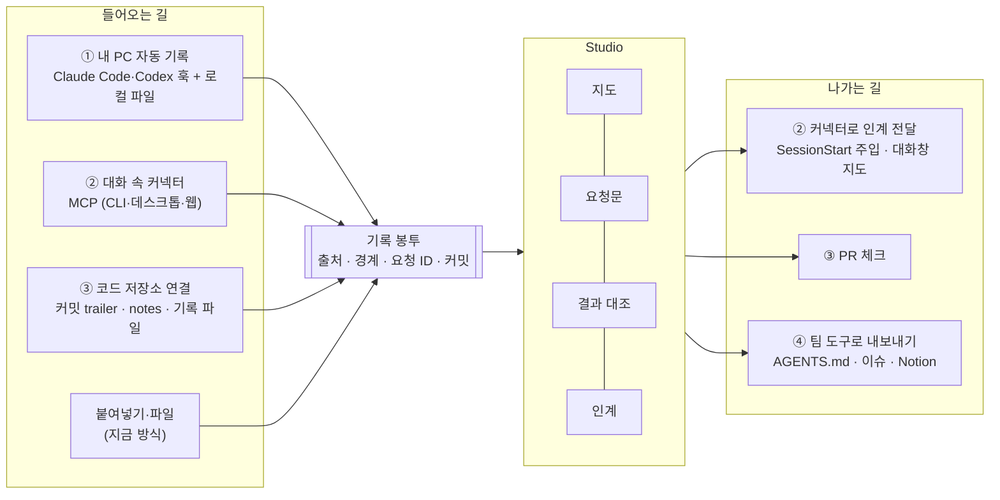

# 연동 지형 조사와 AgentFlow 연동 설계

작성 2026-10-31 · 조사·설계 문서 (코드 변경 없음) · 기준 `work/experience142-reading-delivery`

비슷한 일을 하는 오픈소스와 서비스가 **어떻게 연결되는지** 조사하고, 그 방식들을 AgentFlow Studio에 맞게 다시 조합했습니다.
기능 목록을 늘리는 것이 목적이 아닙니다. 사용자가 고를 수 있는 **연동 방식 몇 가지**와, 그중 지금 먼저 할 세 가지를 정하는 것이 목적입니다.

---

## 한눈에

1. **자리는 아직 비어 있습니다.** 이번에 확인한 도구들은 크게 둘로 나뉩니다. 하나는 기록을 *보관·검색*하는 쪽(세션 뷰어, 트레이싱, 메모리)이고, 다른 하나는 코드를 *설명*하는 쪽(DeepWiki, CodeBoarding, Code Wiki)입니다. 이번 조사 범위에서는 **AI와 나눈 기록을 프로그램 구성 지도에 잇고, 요청과 돌아온 결과를 대조하고, 다음 세션에 넘기는 일**을 한곳에서 하는 도구를 찾지 못했습니다. 제품 방향은 그대로 두는 것이 맞습니다.
2. **연동 방식은 네 가지로 수렴했습니다.** ⓐ 훅으로 *끝난 순간*을 받기, ⓑ MCP로 *AI가 직접 묻고 보고*하기, ⓒ 커밋에 *맥락 ID를 새기기*, ⓓ 사람들이 *이미 보는 곳*(이슈, PR 체크, 대화창)에 상태를 보여주기입니다.
3. **그래서 사용자에게는 연동 방식 네 가지를 고르게 합니다.**
   ① 내 PC 자동 기록 · ② 대화 속 커넥터 · ③ 코드 저장소 연결 · ④ 팀 도구로 내보내기.
   어느 길로 들어와도 같은 **기록 봉투**가 되어 지도·요청·대조·인계에 똑같이 쓰입니다. 지금의 붙여넣기는 그대로 남습니다.
4. **먼저 할 세 가지**
   1. 훅으로 세션 끝 알림 받기 (① · 작음)
   2. 커넥터에 "인계 받기"와 "결과 보고" 두 도구 (② · 중간)
   3. 요청 ID를 커밋에 새기고 실제 변경으로 대조하기 (③ · 작음~중간)

---

## 1. 조사 방법과 한계

- **라이선스와 활성도**는 패키지 레지스트리(npm, PyPI) 메타데이터로 확인했습니다(2026-10-31 조회). 활성도는 *최신 릴리스 날짜*로 적었습니다. 레지스트리에 없는 것은 공식 페이지의 표시를 따랐고, 없으면 "미확인"으로 적었습니다.
- **기능 설명**은 공식 문서·블로그·패키지 README를 읽은 범위입니다. 설치하거나 실행해 보지 않았으므로 실제 동작을 보증하지 않습니다.
- **GitHub 저장소 페이지는 직접 열지 않았습니다.** 이 작업의 GitHub 접근은 우리 저장소로 한정돼 있습니다. 그래서 별(star) 수는 적지 않았습니다.
- Slack 연동, Sourcegraph, Serena, Aider 등은 이번에 원문을 확인하지 못해 목록에서 뺐습니다.

---

## 2. 조사 목록

표의 "활성도"는 최신 릴리스(또는 공식 페이지 갱신) 날짜입니다. "시사점"은 우리에게 겹치는 점이나 빌릴 점입니다.

### A. AI 코딩 세션 기록·뷰어

| 이름 | 라이선스 · 활성도 | 하는 일 | 시사점 |
| --- | --- | --- | --- |
| [Entire](https://entire.com/) | 플랫폼 라이선스 미확인 · 2026 출시 | CLI가 저장소에 훅을 설치해 세션을 기록. 세션 메타는 숨은 브랜치 `entire/checkpoints/v1`에, 커밋에는 12자 Checkpoint ID trailer. 플랫폼은 코드·커밋·세션 통합 검색, 비밀값 가림 | 가장 가까운 상위 개념. 우리는 코드 호스팅이 아니라 지도이므로 경쟁보다 **커밋에 맥락 ID를 새기는 방식**을 빌린다 |
| [git-ai](https://usegitai.com/docs/how-git-ai-works) | 라이선스 미확인 · 1.0 발표 | Pre/PostToolUse 훅으로 편집마다 AI/사람 체크포인트, 커밋 때 git notes에 파일·프롬프트 ID·줄 범위를 담은 Authorship Log | 결과 대조에서 "보고된 변경"과 "실제 AI가 쓴 줄"을 가르는 근거로 읽을 수 있음 |
| [Agent Trace](https://agent-trace.dev/) (Cursor) | CC BY 4.0 · v0.1.0 RFC (2026-01) | 파일·줄 범위 → 대화 URL·기여자(human/ai/mixed)·모델을 기록하는 교환 형식. 저장 위치는 정하지 않음. Amp·Cline·Cognition·git-ai 등이 함께 만듦 | 우리 기록 봉투를 **밖으로 내보낼 때의 형식 후보** |
| [SpecStory CLI](https://docs.specstory.com/integrations/terminal-coding-agents) | 오픈소스 표기, 라이선스 미확인 | `specstory run claude/codex`, `watch`, `sync`로 세션을 `.specstory/history/`에 Markdown으로 저장. 로그인하면 클라우드 동기화(끌 수 있음) | 저장소 안에 남는 기록. **가져오기 어댑터 대상** |
| [Agent Sessions](https://hermesatlas.com/projects/jazzyalex/agent-sessions) | MIT · 6.2 (2026-10-27 갱신) | macOS 로컬 세션 브라우저. Codex·Claude Code 등 16개 이상 형식, 검색, 이어하기 명령 복사, 사용량 표시. 원격 전송 없음 | 우리 세션 목록과 겹침. "기록은 기기 밖으로 나가지 않는다"는 약속을 전면에 둔 점 |
| [claude-code-log](https://pypi.org/project/claude-code-log/) | MIT · 1.7.0 (2026-10-05) | Claude Code JSONL → HTML·Markdown, TUI. Codex는 베타 | 형식 변화에 대응하며 유지되는 파서의 사례 |
| [claude-code-transcripts](https://simonwillison.net/2025/Dec/25/claude-code-transcripts/) | Apache-2.0 · 0.6 (2026-01-25) | 세션을 정적 HTML로, `--gist`로 공유. 커밋 기록에서 해당 대화로 링크 | **커밋 ↔ 대화 링크**의 단순한 형태 |
| [ccusage](https://www.npmjs.com/package/ccusage) | MIT · 20.0.46 (2026-10-30) | 로컬 데이터로 토큰·비용 리포트. Claude Code·Codex 포함 10개 이상 출처 | 여러 도구의 로컬 파일을 계속 따라가는 유지 비용의 사례 |
| [claude-trace](https://www.npmjs.com/package/@mariozechner/claude-trace) | MIT · 1.0.9 (2025-08-13, 이후 없음) | Claude Code의 API 트래픽 전체를 기록해 HTML로 | 원문 전부를 가로채는 방식. 우리 최소 수집 원칙과 반대라 참고만 |
| [Vibe Kanban](https://landscape.jimmysong.io/projects/vibe-kanban/) | Apache-2.0 · npm 0.1.44 (2026-04-24) 이후 릴리스 없음 | 여러 코딩 에이전트 작업을 칸반으로 배치·검토 | **작업 보드와 구성 지도는 다르다**(방향 문서 Q01)는 점을 다시 확인 |

### B. 관측·트레이싱

| 이름 | 라이선스 · 활성도 | 하는 일 | 시사점 |
| --- | --- | --- | --- |
| [Langfuse](https://langfuse.com/integrations/developer-tools/claude-code) | SDK MIT · Python 5.1.0 (2026-10-30) | Claude Code 연동은 전역 **Stop 훅**이 transcript를 읽어 턴·생성·도구 단위 트레이스로 보내고 `session_id`로 묶음. 플러그인으로 설치 | 입력은 우리와 같고 출력이 다름(운영 관측 vs 지도). **훅 + 플러그인 포장**을 그대로 참고 |
| [Arize Phoenix](https://pypi.org/project/arize-phoenix/) | Elastic-2.0 · 21.0.0 (2026-10-30) | OpenTelemetry 기반 LLM 관측 | 라이선스가 OSI 오픈소스가 아님. 코드 재사용 대상 아님 |
| [OpenLLMetry](https://pypi.org/project/traceloop-sdk/) | Apache-2.0 · 0.62.4 (2026-09-29) | LLM 호출을 OTel로 계측하는 SDK | 표준 계측이 이미 있다는 근거. 직접 만들 필요 없음 |
| [LangSmith SDK](https://www.npmjs.com/package/langsmith) | SDK MIT · 0.11.6 (2026-10-31), 서비스 상용 | 트레이싱·평가 서비스의 SDK (기능 문서는 이번에 열지 않음) | 상용 관측 서비스가 넓게 있다는 정도로만 기록 |
| [Helicone](https://helicone.ai/blog/joining-mintlify) | Apache-2.0 · 2026-03-03 Mintlify 인수, 유지보수 모드 | 프록시형 LLM 관측·게이트웨이 | 관측 도구에 기대는 연동은 사라질 수 있음 |
| [OpenTelemetry GenAI 규약](https://opentelemetry.io/docs/specs/semconv/gen-ai/gen-ai-agent-spans) | Apache-2.0 · 별도 저장소로 이전됨 | GenAI·에이전트 스팬 이름과 속성 규약 | 세부 상태는 이번에 미확인 |
| [Claude Code OTel 내보내기](https://www.elastic.co/docs/reference/integrations/claude_code) | 공식 기능 | `CLAUDE_CODE_ENABLE_TELEMETRY=1`로 `user_prompt`, `tool_result`, `api_request` 등 로그 이벤트, 트레이스(베타). **프롬프트 본문은 기본 제외**(`OTEL_LOG_USER_PROMPTS`) | "언제 무엇을 했나" 신호는 표준 경로로 받을 수 있지만 내용이 빠져 지도 원문으로는 부족. 진행 신호용 |

### C. 에이전트 연결 표준과 배포

| 이름 | 라이선스 · 활성도 | 하는 일 | 시사점 |
| --- | --- | --- | --- |
| [Claude Code hooks](https://code.claude.com/docs/en/hooks) | 공식 | 33개 이벤트(SessionStart, Stop, PreCompact, SessionEnd 등). 공통 입력 `session_id`, `transcript_path`, `cwd`. 처리기 `command`·`http`·`mcp_tool`·`prompt`·`agent`. 플러그인이 `hooks/hooks.json`으로 훅을 묶을 수 있음. transcript는 비동기로 쓰여 늦을 수 있음 | **세션 경계를 추측하지 않고 받을 수 있음** |
| [Codex hooks](https://learn.chatgpt.com/docs/hooks.md) | 공식 | 12개 이벤트(SessionStart, Stop, PreCompact, SessionEnd 등). 같은 세 필드. `~/.codex/hooks.json` 또는 `config.toml`, 기본 켜짐, 프로젝트 훅은 신뢰된 경우만. **transcript 형식은 안정 인터페이스가 아니라고 명시** | Claude Code와 같은 방식으로 붙일 수 있음. 파서는 계속 관대해야 함 |
| [MCP TypeScript SDK](https://www.npmjs.com/package/@modelcontextprotocol/sdk) | MIT · 1.32.2 (2026-10-23) | MCP 서버·클라이언트 구현 | 커넥터 구현 기반 |
| [MCP Apps](https://rits.shanghai.nyu.edu/ai/mcp-apps-interactive-uis-become-an-official-part-of-mcp) | 2026-01-26 첫 공식 확장, 2026-07-28 사양 편입 | 도구가 `ui://` 리소스를 선언하면 호스트가 샌드박스 iframe에 HTML을 띄우고 postMessage(JSON-RPC)로 주고받음. Claude 웹·데스크톱, ChatGPT, VS Code Copilot, Goose 등 지원. SDK `@modelcontextprotocol/ext-apps`(라이선스 미확인) | **지도를 AI 대화창 안에 띄울 수 있음** |
| [MCP Registry](https://www.mcpbundles.com/guides/publish-mcp-registry) | 공식 레지스트리 | `server.json` + `mcp-publisher`. `io.github.<계정>/` 네임스페이스는 GitHub 로그인으로 증명, npm은 `mcpName` 필드. 메타데이터만 보관 | 배포가 정리되면 등록만 하면 됨 |
| [MCPB](https://claude.com/docs/connectors/building/mcpb.md) | 공식 툴체인 | `.mcpb`(zip + `manifest.json`)로 로컬 MCP 서버를 Claude Desktop에 한 번에 설치. `user_config`를 적으면 설정 화면이 자동 생성. 디렉터리 등록은 원격 서버를 우선 권장 | Desktop 사용자용 설치 경로 |
| [AGENTS.md](https://openai.com/index/agentic-ai-foundation/) | Agentic AI Foundation 프로젝트 (2025-12-09) | 저장소에 두는 에이전트용 안내 파일. 6만 개 이상 프로젝트 채택(발표 기준). Claude Code는 CLAUDE.md가 없으면 AGENTS.md를 읽음 | **어떤 에이전트든 세션 시작 때 읽는 자리** |
| [Agent Skills](https://codex.danielvaughan.com/2026/05/05/agent-skills-open-standard-portable-skills-codex-cli-cross-agent/) | 2025-12 공개, AAIF 관리 (2차 출처) | `SKILL.md` 묶음. 메타데이터만 먼저 읽고 필요할 때 본문을 읽는 점진 공개. Codex는 `.agents/skills/` | "AgentFlow에 보고하는 법"을 스킬로 배포할 수 있음 |
| [Agent Client Protocol](https://agentic-ai.readthedocs.io/en/latest/Standards/agent-client-protocol/) | Apache-2.0 · Zed 2025-08 | 편집기와 에이전트 사이 JSON-RPC(stdio). Claude Code·Codex는 어댑터로 지원 | 편집기 옆 AgentFlow는 장기 후보. 지금은 관망 |

### D. 코드베이스 지도·문서

| 이름 | 라이선스 · 활성도 | 하는 일 | 시사점 |
| --- | --- | --- | --- |
| [DeepWiki MCP](https://docs.devin.ai/work-with-devin/deepwiki-mcp.md) | 무료 상용 서비스 | `https://mcp.deepwiki.com/mcp`, 인증 없음, 공개 저장소만. 도구 `read_wiki_structure`, `read_wiki_contents`, `ask_question` | **지도를 AI가 MCP로 읽는** 선례. 우리 도구 이름·구성의 참고 |
| [Google Code Wiki](https://alternativeto.net/news/2025/11/google-launches-code-wiki-a-continuously-updated-and-gemini-powered-documentation-platform/) | 서비스 · 2025-11 발표 | 코드 변경마다 위키 재생성, 구조·클래스·시퀀스 다이어그램, 코드 링크, Gemini 채팅. 비공개 저장소용 Gemini CLI 확장 개발 중 | 코드 쪽 지도는 대형 서비스가 채워 가는 영역. 우리는 **코드 이전의 구상과 대화**에서 차별 |
| [CodeBoarding](https://pypi.org/project/codeboarding/) | MIT · 0.15.3 (2026-10-26) | LSP 정적 분석 + LLM으로 계층 다이어그램. Mermaid와 `analysis.json`. VS Code·GitHub Action·MCP. `incremental`은 두 git ref 사이 변경만 재분석 | 코드가 생긴 뒤의 **보조 증거층** 후보. 증분 갱신 설계 참고 |
| [Swimm](https://docs.swimm.io/features/keep-docs-updated-with-auto-sync/) | 상용 | Auto-sync: 사소한 코드 변경은 CI가 문서를 자동 갱신, 중요한 변경은 검증 체크를 실패시켜 사람 검토 요청 | 우리 "자동 반영과 사람 확인을 가른다"는 원칙과 같은 철학. **PR 체크로 드러내는 방식** |
| [CodeSee](https://sdtimes.com/software-development/gitkraken-acquires-codesee-launches-new-devex-platform/) | 2024-05-14 GitKraken 인수 발표 | 코드베이스 지도 | 단독 제품 지속 여부 미확인. 코드 지도 단독 제품의 지속성 위험 |
| [Repomix](https://www.npmjs.com/package/repomix) | MIT · 1.18.1 (2026-09-21) | 저장소를 AI용 단일 파일로 묶음 | 인계 문서에 코드 맥락을 붙일 때의 참고 |
| [Context7](https://www.npmjs.com/package/@upstash/context7-mcp) | MIT · 4.4.4 (2026-10-19) | 최신 라이브러리 문서를 MCP로 제공 | 외부 지식은 이미 MCP로 공급됨. 우리는 **프로젝트 고유 맥락**에 집중 |

### E. 기억·인수인계

| 이름 | 라이선스 · 활성도 | 하는 일 | 시사점 |
| --- | --- | --- | --- |
| [Claude Code 메모리](https://code.claude.com/docs/en/memory) | 공식 | 사람이 쓰는 CLAUDE.md(또는 AGENTS.md)와 Claude가 쓰는 auto memory. auto memory는 세션 시작 때 첫 200줄(또는 25KB)을 읽음 | 인계는 **세션 시작 때 읽히는 자리**에 놓여야 효과가 있음 |
| [claude-mem](https://www.npmjs.com/package/claude-mem) | Apache-2.0 · 15.7.0 (2026-10-30) | 훅으로 도구 사용을 관찰·요약하고, SessionStart에서 `additionalContext`로 다음 세션에 주입. PreCompact에서 압축. 여러 하네스 지원. 설치 시 호스팅 메모리 체험을 권함(끌 수 있음) | 입력은 같고 출력이 다름(기억 vs 지도). **SessionStart 주입**은 AI가 도구 호출을 잊어도 인계가 전달되는 길 |
| [mem0 · OpenMemory MCP](https://mem0.ai/blog/introducing-openmemory-mcp) | Apache-2.0 · mem0ai 2.2.1/3.3.1 (2026-09-25) | 로컬 메모리 MCP(`add_memories`, `search_memory` 등). 대시보드에서 **클라이언트별 접근 허용** | "연결" 화면에서 도구별로 켜고 끄는 UI 참고 |
| [Letta](https://docs.letta.com/guides/core-concepts/agent-file/index.md) | Apache-2.0 · 0.34.12 (2026-10-12) | 메모리 블록. Agent File(`.af`)로 상태를 옮기고 체크포인트 | 인계 문서를 **이식 가능한 파일 한 장**으로 |
| [Graphiti](https://pypi.org/project/graphiti-core) (Zep) | Apache-2.0 · 0.31.2 (2026-10-20) | 사실마다 유효 기간이 있는 그래프. 바뀐 사실은 지우지 않고 무효화, 에피소드로 출처 추적, 증분 갱신. MCP 서버는 인증 없는 참조 구현 | 우리 지도의 "현재·이력·철회" 모델과 가장 닮음. **데이터 모델 참고**(코드 도입 아님) |
| [Beads](https://beads.gascity.com/core-concepts) | MIT · @beads/bd 1.3.2 (2026-10-24) | 에이전트용 이슈 트래커. Dolt 저장, 의존 유형(blocks, parent-child, discovered-from, related), `bd ready`로 지금 맡길 수 있는 일 | 지도 부분마다 **"지금 맡길 수 있는 일"**을 보여주는 아이디어 |
| [OpenSpec](https://www.npmjs.com/package/@fission-ai/openspec) | MIT · 1.16.0 (2026-10-30) | 스펙 주도 개발 프레임워크 | 기존 조사(research021)에서 다룸. 이번엔 활성도만 갱신 |

### F. 팀 작업 도구 연동

| 이름 | 성격 | 하는 일 | 시사점 |
| --- | --- | --- | --- |
| [GitHub Checks API](https://docs.github.com/es/rest/checks/runs) | 공식 API | **GitHub App만** Check Run 생성 가능. 요약·본문 Markdown, 줄 주석 요청당 50개, 완료 후 버튼 최대 3개(`check_run.requested_action` 웹훅), `details_url` | "요청 대조 결과"를 PR 체크로, 상세는 지도로 연결 |
| [Linear Agents](https://linear.app/developers/agent-interaction.md) | 공식 API | AgentSession 상태(pending/active/awaitingInput/complete 등)를 마지막 활동으로 자동 결정. 활동 종류 thought·action·elicitation·response·error. 생성 후 10초 안에 응답, 외부 URL, 계획 체크리스트(프리뷰) | 에이전트 진행을 작업 도구 안에 보여주는 가장 정돈된 모델. **부분 상태 어휘**에 참고 |
| [Notion MCP](https://developers.notion.com/docs/get-started-with-mcp) | 공식 원격 MCP | `https://mcp.notion.com/mcp`, OAuth. 페이지 생성·수정·댓글. Claude Code·Codex 등 지원 | 우리 서버가 Notion에 붙을 필요 없음. **사용자의 AI가 이미 가진 MCP로 보내게** 하면 됨 |

### G. 웹 AI 대화 캡처

| 이름 | 라이선스 · 활성도 | 하는 일 | 시사점 |
| --- | --- | --- | --- |
| [AI Chat Exporter](https://greasyfork.org/scripts/541051) (userscript) | MIT · 3.1.0 (2026-03-23) | ChatGPT·Claude·Copilot·Gemini·Grok 대화를 DOM에서 읽어 Markdown·JSON으로. 선택자 깨짐 수리 이력 | DOM 스크래핑은 사이트 변경에 깨짐. **주 경로로 부적합** |
| [Obsidian Web Clipper Interpreter](https://obsidian.md/help/web-clipper/interpreter) | 라이선스 미확인 | 템플릿의 프롬프트 변수로 페이지 내용을 LLM이 추출. 공급자를 직접 호출 | "붙여넣기 전에 정리" 단계를 브라우저에서 하는 형태 |
| 원격 MCP 커넥터 | 표준 | Claude 웹과 ChatGPT는 MCP Apps 지원 호스트 목록에 있음 | 웹 AI가 **직접 기록을 보내는** 길이 스크래핑보다 견고. 아래 ②에 흡수 |

---

## 3. 업계가 수렴한 연동 패턴

| 패턴 | 하는 방식 | 대표 사례 | 우리에게 의미 |
| --- | --- | --- | --- |
| **끝난 순간 받기** | 에이전트 훅이 세션 경계마다 `session_id`·`transcript_path`·`cwd`를 넘김 | Langfuse, claude-mem, git-ai, Entire | 지금의 "2분간 변화 없음" 추측과 5분 주기를 **정확한 경계**로 바꿀 수 있음 |
| **AI가 직접 묻고 보고** | MCP 도구·리소스, 그리고 SessionStart 주입 | DeepWiki, OpenMemory, CodeBoarding, claude-mem | 인계를 *복사해 붙이는* 대신 AI가 *가져가고*, 결과를 *직접 돌려줌* |
| **커밋에 맥락 새기기** | commit trailer, git notes, 표준 기록 형식 | Entire, git-ai, Agent Trace, claude-code-transcripts | "보고"가 아니라 **실제 변경** 기준으로 결과를 대조 |
| **이미 보는 곳에 보여주기** | 이슈 안 에이전트 세션, PR 체크, 대화창 안 UI | Linear Agents, GitHub Checks, Swimm, MCP Apps | 사용자가 Studio를 열지 않아도 상태를 봄 |
| **한 번에 설치** | 훅·MCP·스킬을 한 묶음으로 | Claude Code 플러그인, Codex 플러그인, MCPB, MCP Registry | 연동 방식마다 설치가 따로면 아무도 켜지 않음 |

공통 원칙도 뚜렷합니다. Claude Code OTel은 프롬프트 본문을 기본으로 빼고, Agent Sessions는 기기 밖 전송이 없다고 약속하고, Entire는 저장 전에 비밀값을 가립니다. 우리 현재 원칙(사람 발화와 최종 답만 읽기, `shared/secret.ts`로 가리기, 읽기만 하기)과 같은 방향입니다. **연동을 늘려도 이 원칙은 그대로 갑니다.**

---

## 4. 연동 방식: 사용자가 고르는 네 가지

사용자는 "연결" 화면에서 하나 이상을 켭니다. 아무것도 켜지 않아도 지금의 붙여넣기와 파일 입력은 그대로입니다.

| 옵션 | 한 줄 | 잘 맞는 사람 | 설치 | 들어오는 것 | 나가는 것 |
| --- | --- | --- | --- | --- | --- |
| **① 내 PC 자동 기록** | 켜 두면 알아서 | PC에서 Claude Code·Codex를 쓰는 사람 | 플러그인 하나(또는 훅 설정 몇 줄) | 세션 경계 알림 → 기존 파일 읽기 | 없음 |
| **② 대화 속 커넥터** | AI가 직접 묻고 보고 | 여러 도구를 쓰거나 웹 AI를 쓰는 사람 | MCP 추가(로컬 또는 원격) | 결과 보고, 웹 AI 기록 | 인계, 지도 조회, 대화창 지도 카드 |
| **③ 코드 저장소 연결** | 요청과 실제 변경을 잇기 | 코드가 생긴 프로젝트 | 요청문에 한 줄, 선택적으로 GitHub App | 요청 ID가 붙은 커밋과 변경 파일, 다른 도구가 남긴 기록 | PR 체크 |
| **④ 팀 도구로 내보내기** | 있는 곳에 보여주기 | 혼자가 아니거나 이슈 트래커를 쓰는 사람 | 없음(파일·사용자의 AI 경유) | 없음 | AGENTS.md 블록, 이슈·Notion 페이지 |

### ① 내 PC 자동 기록 · "켜 두면 알아서"

- **무엇이 달라지나.** Claude Code·Codex의 훅이 세션의 끝(`Stop`, `SessionEnd`)과 압축 직전(`PreCompact`)을 로컬 Studio에 알립니다. Studio는 지금처럼 파일을 읽기만 하되, *언제 읽을지*를 추측하지 않습니다. 압축으로 대화 앞부분이 사라지기 전에 읽을 기회도 생깁니다.
- **빌려온 것.** Langfuse의 Stop 훅, claude-mem의 SessionStart·PreCompact, Entire의 `entire enable` 한 번 설치.
- **설치.** Claude Code는 훅만 담은 플러그인 하나. Codex는 `~/.codex/hooks.json` 스니펫 또는 플러그인.
- **가치** 높음 · **난이도** 낮음~중간 · **의존** 로컬 Node 서버가 켜져 있을 것(꺼져 있으면 지금의 주기 읽기로 그대로 동작)
- **돕는 흐름** 프로젝트 가져오기(방향 문서 4절 1), 외부 작업 이어 반영(4절 6)
- **주의.** transcript는 늦게 쓰일 수 있고, Codex는 형식을 안정 인터페이스로 약속하지 않습니다. 훅은 "지금 읽어도 된다"만 알리고 해석은 기존 `session-parse`에 맡깁니다. 훅이 넘긴 경로는 서버가 알려진 두 폴더 안인지 다시 확인합니다.

### ② 대화 속 커넥터 · "AI가 직접 묻고 보고"

- **무엇이 달라지나.** AgentFlow MCP 서버를 AI 도구에 추가하면, AI가 작업을 시작할 때 해당 부분의 인계를 *가져가고*, 끝나면 결과를 *돌려줍니다*. 사람이 복사·붙여넣기로 오가던 두 지점이 사라집니다.
- **핵심 도구는 셋으로 충분합니다.**
  - `handover`: 프로젝트(또는 한 부분)의 인계 문서. 기존 `handover.ts` 출력과 `af-handover` 표식을 그대로 씀
  - `report`: 요청 ID·요약·바뀐 파일·검사 결과를 받아 `agentflow.return.2` 후보로 저장. **반영은 사용자가 Studio에서 확인한 뒤**(지금의 명시적 반영 원칙 유지)
  - `map`: 부분과 관계 조회(DeepWiki의 `read_wiki_structure`에 해당)
- **확장.** MCP Apps로 대화창 안에 "지금 보고 있는 부분과 그 관계" 카드를 띄웁니다. Claude 웹·데스크톱, ChatGPT, VS Code에서 같은 UI가 뜹니다.
- **배포는 세 갈래.** 로컬 stdio(Claude Code 플러그인, Codex 설정, Desktop용 MCPB) · 원격 HTTP(claude.ai·ChatGPT 웹) · MCP Registry 등록(`io.github.tlsee0813-cmd/agentflow`).
- **빌려온 것.** DeepWiki의 지도 읽기 도구 구성, claude-mem의 SessionStart 주입, OpenMemory의 클라이언트별 허용, MCPB의 `user_config` 설정 화면.
- **가치** 매우 높음(결과 대조 왕복을 닫고, 웹 AI 기록을 스크래핑 없이 받음) · **난이도** 중간(로컬) ~ 높음(원격: 인증과 데이터 위치) · **의존** MCP 커넥터 작업
- **돕는 흐름** 구상 구체화(4절 2), 맡기기·세션 교체(4절 5), 이어 반영(4절 6)
- **주의.** 도구 호출은 AI가 잊으면 일어나지 않습니다. 그래서 ①의 훅이 안전망이고, 인계는 SessionStart 주입으로도 전달합니다.

### ③ 코드 저장소 연결 · "요청과 실제 변경을 잇기"

- **무엇이 달라지나.** 결과 대조가 AI의 *보고*만이 아니라 *실제 커밋*을 근거로 삼습니다.
- **세 단계로 나눕니다.**
  1. **요청 ID trailer.** 고정 요청문과 인계문에 "커밋 메시지 끝에 `AgentFlow-Request: <요청 ID>`를 붙이세요" 한 줄을 넣습니다. Studio는 묶인 작업 폴더의 git 기록에서 그 커밋과 바뀐 파일을 읽어 결과 대조 옆에 "실제 변경"으로 보여줍니다.
  2. **이미 남은 기록 읽기.** 저장소에 Entire 체크포인트 브랜치, git-ai notes, Agent Trace 기록, `.specstory/history`가 있으면 가져오기 어댑터로 읽습니다. 우리가 만들지 않은 기록도 지도에 들어옵니다.
  3. **PR 체크(선택).** GitHub App이 PR에 "요청 대조" Check Run을 남깁니다. 요약은 PR에, 상세는 `details_url`로 지도에, 버튼은 "지도에서 보기"·"다시 대조".
- **빌려온 것.** Entire의 커밋 trailer, git-ai의 notes, Agent Trace 형식, Swimm의 검증 체크.
- **가치** 높음("보고는 검증 완료가 아니다" 원칙을 실제 근거로 받침) · **난이도** 1단계 낮음, 2단계 중간, 3단계 높음(App 호스팅·권한) · **의존** git 저장소, 로컬 서버
- **돕는 흐름** 이어 반영(4절 6)과 돌아온 결과 읽기

### ④ 팀 도구로 내보내기 · "있는 곳에 보여주기"

- **무엇이 달라지나.** 인계 문서와 고정 요청문을 사람과 에이전트가 이미 보는 곳에 둡니다.
  - **AGENTS.md 블록.** 저장소의 AGENTS.md(또는 CLAUDE.md가 가져오는 파일)에 "현재 지도 요약·열린 결정·맡길 수 있는 일" 블록을 씁니다. 어떤 에이전트든 세션 시작 때 읽습니다.
  - **이슈·Notion 페이지.** 우리 서버가 각 서비스에 붙지 않습니다. 인계 문서에 "이 내용을 Linear 이슈로 만들어 주세요" 같은 지시를 붙이면, 사용자의 AI가 이미 가진 MCP(Notion MCP 등)로 보냅니다. 우리는 토큰을 보관하지 않습니다.
- **장기 후보.** AgentFlow를 Linear 에이전트로 등록해 이슈 안에 해당 부분 상태를 보여주는 방식. 10초 응답 요건 때문에 상시 서버가 필요해 지금은 보류합니다.
- **빌려온 것.** AGENTS.md 관행, Beads의 "ready" 개념, Linear의 에이전트 세션 어휘, Notion MCP.
- **가치** 중간 · **난이도** 낮음(파일·사용자 AI 경유) ~ 높음(Linear 에이전트) · **돕는 흐름** 맡기기(4절 5), 구조 발전(4절 7)

### 공통 기반: 기록 봉투와 "연결" 화면

- **기록 봉투.** 네 길이 모두 같은 모양으로 들어옵니다. 지금의 기록 머리줄(`session-import.ts`의 `RECORD_HEAD`)을 *대체하지 않고 넓힙니다.*
  - 출처: 도구, 세션 ID, 작업 폴더, 브랜치
  - 경계: 턴 끝 · 세션 끝 · 압축 직전 · 결과 보고
  - 내용: 사람 발화, 최종 답, 바뀐 파일(지금과 같은 범위)
  - 연결: 요청 ID, 커밋(있을 때)
  - 비밀값 가림은 모든 길에 똑같이 적용
  - 밖으로 내보낼 때는 파일·줄 범위를 Agent Trace 형식으로 옮길 수 있게 필드 이름을 맞춤
- **"연결" 화면.** 네 옵션을 카드로 보여줍니다. 카드마다 켜짐 여부, 마지막으로 받은 시각, *받는 것과 받지 않는 것*, 끄기. OpenMemory의 클라이언트별 허용과 MCPB의 자동 설정 화면에서 빌려옵니다.

---

## 5. 추천 우선순위

| 순위 | 제안 | 옵션 | 가치 | 난이도 | 먼저 필요한 것 |
| --- | --- | --- | --- | --- | --- |
| 1 | 훅으로 세션 끝 알림 | ① | 높음 | 낮음 | 없음 |
| 2 | 커넥터 `handover`·`report` + SessionStart 주입 | ② 로컬 | 매우 높음 | 중간 | MCP 커넥터 기본 골격, 데이터 위치 결정 |
| 3 | 요청 ID trailer와 실제 변경 대조 | ③-1 | 높음 | 낮음~중간 | 없음 |
| 4 | 대화창 지도 카드 (MCP Apps) | ② | 높음 | 중간 | 2 |
| 5 | AGENTS.md 지도 요약 블록 | ④ | 중간 | 낮음 | 없음 |
| 6 | 다른 도구 기록 가져오기 어댑터 | ③-2 | 중간 | 중간 | 기록 봉투 |
| 7 | 원격 커넥터 (웹 AI) | ② 원격 | 높음 | 높음 | 인증, 서버 쪽 프로젝트 보관 결정 |
| 8 | PR "요청 대조" 체크 | ③-3 | 중간 | 높음 | GitHub App 호스팅 |
| 9 | Linear 에이전트 | ④ | 낮음~중간 | 높음 | 상시 서버 |

**하지 않을 것**

- 자체 관측 백엔드 만들기. Langfuse·Phoenix·OTel이 이미 있고, 우리 일은 운영 관측이 아닙니다.
- DOM 스크래핑 확장을 주 경로로 삼기. 깨지기 쉽고, 원격 커넥터가 더 견고합니다.
- 도구 출력·추론 전체 수집, API 트래픽 가로채기. 최소 수집 원칙과 맞지 않습니다.
- 서비스마다 직접 OAuth 연동. 사용자의 AI가 가진 MCP를 경유합니다.

---

## 6. 먼저 할 세 가지

### 제안 1 · 훅으로 세션 끝 알림 받기

- **장면.** Claude Code에서 작업을 마치고 Studio를 열면, 방금 대화가 이미 기록과 지도 갱신 대기열에 있습니다. 2분을 기다리지 않습니다.
- **동작.**
  - Claude Code: 플러그인의 `hooks.json`에 `Stop`·`SessionEnd`·`PreCompact`. `http` 처리기로 `127.0.0.1`의 Studio에 `{session_id, transcript_path, cwd, hook_event_name}`을 보냅니다. 지금의 요청 헤더 조건(`X-AgentFlow-Request`)을 http 처리기에서 줄 수 있는지는 구현 때 확인하고, 안 되면 `command` 처리기의 작은 스크립트로 보냅니다.
  - Codex: `hooks.json`의 `command` 처리기로 같은 본문을 보냅니다.
  - 서버: 경로가 두 기록 폴더 안인지 확인하고 그 세션을 "정리됨"으로 표시합니다. 브라우저 자동 연결은 다음 확인 때 2분 대기 없이 가져갑니다.
- **완료 기준.** 훅이 없으면 지금과 똑같이 동작합니다. 훅이 있으면 Stop 뒤 다음 확인에서 들어옵니다. 폴더 밖 경로는 거절됩니다.
- **범위 밖.** 서버가 브라우저로 밀어 주기(push), 하루 30회 한도 변경.

### 제안 2 · 커넥터의 "인계 받기"와 "결과 보고"

- **장면.** 새 세션에서 "결제 부분 이어서 해 줘"라고 하면 AI가 AgentFlow에서 그 부분의 인계를 가져와 시작합니다. 끝나면 "AgentFlow에 보고해 줘" 한마디로 결과가 Studio의 확인 대기에 들어갑니다.
- **동작.**
  - `handover(part?)` → 기존 인계 문서 생성기의 출력을 그대로 돌려줌
  - `report(request_id, summary, changed_files, checks)` → `agentflow.return.2` 후보로 저장, Studio에서 사용자가 확인 후 반영
  - ①의 SessionStart 훅이 작업 폴더에 묶인 프로젝트가 있으면 인계 요약을 `additionalContext`로 넣음. AI가 도구를 부르지 않아도 인계가 전달됩니다
- **먼저 풀 쟁점.** 지금 프로젝트 데이터는 **브라우저 localStorage**에 있고 서버는 보관하지 않습니다. 로컬 MCP 서버가 인계를 돌려주려면, 브라우저가 프로젝트별 인계·지도 요약을 로컬 서버(`.studio-data/`)에 *내려 두는* 단계가 필요합니다. 결과 보고도 서버에 *대기*시켰다가 브라우저가 가져가는 방식이 자연스럽습니다. 지금의 지도 작업 보관(`map-jobs`)과 같은 모양입니다.
- **완료 기준.** Claude Code와 Codex에서 각각 인계를 받아 시작하고, 보고가 Studio 확인 대기에 나타나며, 확인 전에는 프로젝트가 바뀌지 않습니다.

### 제안 3 · 요청 ID를 커밋에 새기고 실제 변경으로 대조하기

- **장면.** 결과 대조 화면에서 AI의 보고 옆에 "이 요청으로 만들어진 커밋 2개, 바뀐 파일 5개"가 함께 보입니다. 보고에 없는 파일이 바뀌었으면 눈에 띕니다.
- **동작.**
  - 고정 요청문·인계문 내보내기에 trailer 지시 한 줄을 추가
  - 로컬 서버에 읽기 전용 경로 추가: 묶인 작업 폴더에서 `git log --grep "AgentFlow-Request: <ID>"`로 커밋 목록, 바뀐 파일, 변경 통계. 전체 diff는 기본으로 가져오지 않음
  - 결과 대조 화면에 "실제 변경" 근거로 표시
- **완료 기준.** trailer가 없으면 지금과 같습니다. 있으면 커밋과 파일이 표시되고, 보고된 파일과 실제 파일의 차이가 구분됩니다.
- **위험.** AI가 trailer를 빼먹을 수 있습니다. 이후 ③-2 어댑터나 커밋 훅으로 보강합니다. Entire가 같은 방식을 택했다는 점이 방향의 근거입니다.

---

## 7. MCP 커넥터 작업에 넘기는 요점

1. 도구는 `handover`·`report`·`map` 셋으로 시작하면 충분합니다. 보고는 자동 반영하지 말고 확인 대기로 넣습니다.
2. AI가 도구 호출을 잊는 경우를 대비해 **훅을 함께 묶은 플러그인**으로 배포합니다(Claude Code·Codex 모두 플러그인이 훅을 묶을 수 있음). SessionStart 주입이 인계의 안전망입니다.
3. 가장 먼저 풀 설계 쟁점은 **데이터 위치**입니다. 프로젝트가 브라우저에만 있으므로 로컬 서버에 인계·지도 요약을 내려 두는 단계가 필요합니다.
4. 대화창 지도는 MCP Apps(`ui://`)로 Claude·ChatGPT·VS Code에서 같은 UI를 띄울 수 있습니다. 다음 단계 후보입니다.
5. 설치 경로는 Claude Code 플러그인, Codex 설정, Desktop용 MCPB, 그리고 MCP Registry 등록입니다. 원격(웹 AI)은 인증과 서버 보관 결정 뒤로 미룹니다.

---

## 출처 (확인일 2026-10-31)

레지스트리 메타데이터: npm(`registry.npmjs.org`)과 PyPI(`pypi.org/pypi/<이름>/json`)에서 ccusage, @mariozechner/claude-trace, vibe-kanban, repomix, langfuse, langsmith, @arizeai/phoenix-otel, @traceloop/node-server-sdk, @modelcontextprotocol/sdk, @upstash/context7-mcp, mem0ai, @fission-ai/openspec, claude-mem, @beads/bd, claude-code-log, claude-code-transcripts, arize-phoenix, graphiti-core, letta, codeboarding, opentelemetry-semantic-conventions, traceloop-sdk를 조회.

- Entire: https://entire.com/index.md · https://ostechnix.com/entire-cli-git-observability-ai-agents/
- git-ai: https://usegitai.com/docs/how-git-ai-works
- Agent Trace: https://agent-trace.dev/
- SpecStory: https://docs.specstory.com/integrations/terminal-coding-agents
- Agent Sessions: https://hermesatlas.com/projects/jazzyalex/agent-sessions
- claude-code-transcripts: https://simonwillison.net/2025/Dec/25/claude-code-transcripts/
- Vibe Kanban: https://landscape.jimmysong.io/projects/vibe-kanban/
- Langfuse × Claude Code: https://langfuse.com/integrations/developer-tools/claude-code.md
- Helicone 인수: https://helicone.ai/blog/joining-mintlify
- OTel GenAI 이전 안내: https://opentelemetry.io/docs/specs/semconv/gen-ai/gen-ai-agent-spans
- Claude Code OTel: https://www.elastic.co/docs/reference/integrations/claude_code
- Claude Code hooks: https://code.claude.com/docs/en/hooks
- Claude Code 메모리: https://code.claude.com/docs/en/memory
- Codex hooks: https://learn.chatgpt.com/docs/hooks.md
- MCP Apps: https://rits.shanghai.nyu.edu/ai/mcp-apps-interactive-uis-become-an-official-part-of-mcp
- MCP Registry 게시: https://www.mcpbundles.com/guides/publish-mcp-registry
- MCPB: https://claude.com/docs/connectors/building/mcpb.md
- AGENTS.md·AAIF: https://openai.com/index/agentic-ai-foundation/
- Agent Skills: https://codex.danielvaughan.com/2026/05/05/agent-skills-open-standard-portable-skills-codex-cli-cross-agent/
- ACP: https://agentic-ai.readthedocs.io/en/latest/Standards/agent-client-protocol/
- DeepWiki MCP: https://docs.devin.ai/work-with-devin/deepwiki-mcp.md
- Google Code Wiki: https://alternativeto.net/news/2025/11/google-launches-code-wiki-a-continuously-updated-and-gemini-powered-documentation-platform/
- CodeBoarding: https://pypi.org/project/codeboarding/
- Swimm Auto-sync: https://docs.swimm.io/features/keep-docs-updated-with-auto-sync/
- CodeSee 인수: https://sdtimes.com/software-development/gitkraken-acquires-codesee-launches-new-devex-platform/
- claude-mem 훅: https://docs.claude-mem.ai/configuration/hooks
- OpenMemory MCP: https://mem0.ai/blog/introducing-openmemory-mcp
- Letta Agent File: https://docs.letta.com/guides/core-concepts/agent-file/index.md
- Graphiti: https://pypi.org/project/graphiti-core
- Beads: https://beads.gascity.com/core-concepts
- GitHub Check Runs: https://docs.github.com/es/rest/checks/runs
- Linear 에이전트: https://linear.app/developers/agent-interaction.md
- Notion MCP: https://developers.notion.com/docs/get-started-with-mcp
- AI Chat Exporter: https://greasyfork.org/scripts/541051
- Obsidian Web Clipper Interpreter: https://obsidian.md/help/web-clipper/interpreter
