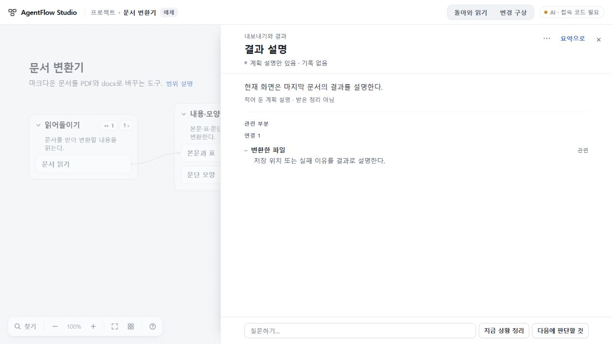

# 웹사이트와 직접 확인할 경로

2026-10-30 KST 정리. 이번에는 주소·현재 BUILD·실제 진입 화면을 확인했다. 새 모델 호출, 사용자 자료 수정, 제품 재배포는 하지 않았다. 사이트가 열리는 것과 AI 의미 품질 통과를 구분한다. [HTTP/BUILD 증거](evidence/website-http.json).

| 주소 | 실제 확인한 판본·역할 | 검토할 때의 한계 |
| --- | --- | --- |
| [기존 지도 작업용 공개판](https://agentflow-studio-existing-map-124.tlsee0813.workers.dev/) | source76e3dc8a2939a4055ab1b99526b5cc1c98fd75e7, release=existing-map. 최신 전달142. 135 기반에140 읽기 수리를 좁게 조합 | 최신 전체 개발본이 아니다. 첫 지도/새 기록 지도 갱신은 보류. 보호된 AI 정리는 접속 코드 필요 |
| [기존 전체 공개판73](https://agentflow-studio.tlsee0813.workers.dev/) | source26b24b935567a95d101720cbf0e06d188d8765d9 | 75 이후 개선을 모두 포함하지 않는다. 오래된 공개 비교 기준 |
| [보조 정적 Pages](https://tlsee0813-cmd.github.io/agentflow-studio/) | 같은73 source26b24b9355. BUILD에 auxiliary static build와 primary 주소 명시 | 서버 AI가 없는 정적 보조 체험.142나 최신 로컬판이 아니다 |
| 로컬 PC http://127.0.0.1:4327/ | 기존 로컬 서버의 HTTP200 확인. 기존142 인수인계상 전체 개발계열140 app93be1c55 환경이며 이번 정리에서 로컬 화면 재검증은 하지 않음 | 이 사용자 PC에서만 접근 가능. 다른 Claude 세션/클라우드에서는 이 주소로 사용자 PC를 열 수 없다. BUILD.txt는404이며 공개 BUILD처럼 판본을 증명하지 않는다 |

## 새 브라우저에서도 볼 수 있는 화면

1. 기존 지도 공개판 홈에서 **문서 변환기**를 연다. 예제와 “작성한 구조·이 탭에서만 남음” 표시를 확인한다.
2. **결과 설명 → 전체 읽기**를 연다. 넓은 읽기면, 관련 부분 이동, **요약으로** 복귀를 확인할 수 있다. 이 예제의 설명은 계획 설명이며 실제 수신/AI 성공 증거가 아니다.
3. 홈의 **변경 구상 시험해 보기**는 지금과 구상을 비교하는 예제 진입점이다. **AgentFlow UI62 개발 자료 → 돌아와 읽기**는 공개 개발자료를 사후 편집한 예제다. 이 두 경로는 기존 배포에 있는 안내이며 이번 정리에서 새 생성·전체 완주 검사를 실행하지 않았다.
4. 실제 Zephyr 자료에서의 넓은 읽기·정확 원문 왕복은 [142 실제 공개 수용](https://github.com/tlsee0813-cmd/agentflow-studio/blob/c57d7fba020cf8226d1ec16c95b85f5d97fce0ed/docs/cycles/2026-10-30-reading-delivery-142/RESULT.md)의 화면과 증거를 본다.

## 자료가 보이는 범위

프로젝트는 브라우저·사이트 origin별 저장값이다. 이 사용자의 Zephyr, 실제 작업 기록, 질문·요청 이력은 다른 사람이나 새 클라우드 세션에 자동으로 나타나지 않는다. 개별 프로젝트 URL만 전달한다고 해당 자료가 공유되는 것이 아니다. 검토자는 공통 예제와 GitHub의 고정 증거를 먼저 사용한다. 원자료가 필요하면 공개한 사례 문서/fixture를 선택하고, 사용자의 비공개 workspace 전체를 임의 게시하지 않는다.

수용142의 네트워크 경계는 map/jobs403 MAP_WITHHELD, 무인증 plan401 ACCESS_CODE_REQUIRED다. 이는142 배포 때 확인한 근거이며 이번 정리에서는 모델 endpoint를 다시 호출하지 않았다. 공개73와 보조 Pages, 기존지도142는 별도 배포물로 유지한다.
